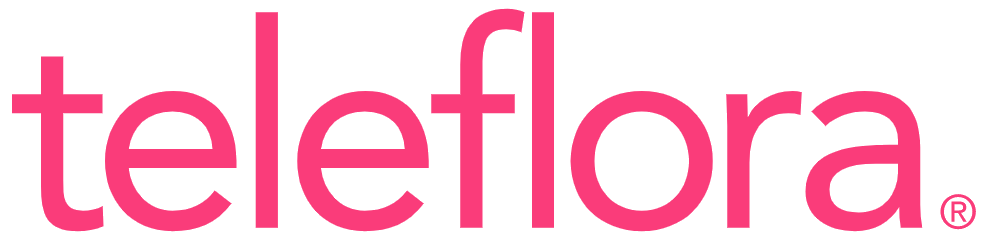

# Credits

[Documentation index](README.md) · [References](REFERENCES.md)

Thank you to the companies and open-source communities whose platforms, tools,
and hardware help make MYKOS possible. Special thanks to Dell and Teleflora.

## Special thanks

<table class="credits-table"><thead><tr><th>Icon</th><th>Company or project</th><th>Credit</th></tr></thead><tbody>
<tr><td></td><td><a href="https://www.dell.com/">Dell</a></td><td>Server hardware used to run MYKOS.</td></tr>
<tr><td></td><td><a href="https://www.teleflora.com/">Teleflora</a></td><td>Special acknowledgment and thanks.</td></tr>
</tbody></table>

## Operating system vendors and communities

<table class="credits-table"><thead><tr><th>Icon</th><th>Company or project</th><th>Credit</th></tr></thead><tbody>
<tr><td></td><td><a href="https://www.redhat.com/">Red Hat</a></td><td>Red Hat Enterprise Linux host and guest platforms.</td></tr>
<tr><td></td><td><a href="https://rockylinux.org/">Rocky Linux</a></td><td>Rocky Linux guest images.</td></tr>
<tr><td></td><td><a href="https://almalinux.org/">AlmaLinux OS Foundation</a></td><td>AlmaLinux guests and upstream compatibility work.</td></tr>
<tr><td></td><td><a href="https://www.oracle.com/">Oracle</a></td><td>Oracle Linux guest images.</td></tr>
<tr><td></td><td><a href="https://www.centos.org/">CentOS Project</a></td><td>CentOS Stream guest images.</td></tr>
<tr><td></td><td><a href="https://fedoraproject.org/">Fedora Project</a></td><td>Fedora guest images and installer tooling.</td></tr>
<tr><td></td><td><a href="https://canonical.com/">Canonical</a></td><td>Ubuntu desktop guests. <a href="https://ubuntu.com/">Ubuntu</a></td></tr>
<tr><td></td><td><a href="https://ubuntu.com/">Ubuntu</a></td><td>Ubuntu operating system and desktop installation resources.</td></tr>
<tr><td></td><td><a href="https://www.microsoft.com/">Microsoft</a></td><td>Windows, Windows Server, and SQL Server image families.</td></tr>
<tr><td></td><td><a href="https://www.apple.com/">Apple</a></td><td>macOS guest platform.</td></tr>
</tbody></table>

## Development and infrastructure

<table class="credits-table"><thead><tr><th>Icon</th><th>Company or project</th><th>Credit</th></tr></thead><tbody>
<tr><td></td><td><a href="https://openai.com/">OpenAI</a></td><td><a href="https://openai.com/codex/">Codex</a> and <a href="https://chatgpt.com/">ChatGPT</a>: AI-assisted development, troubleshooting, documentation, and review.</td></tr>
<tr><td></td><td><a href="https://github.com/">GitHub</a></td><td>Source hosting, collaboration, and releases.</td></tr>
<tr><td></td><td><a href="https://www.cisco.com/">Cisco</a></td><td>Meraki networking, VPN integration, and location information. <a href="https://meraki.cisco.com/">Cisco Meraki</a></td></tr>
<tr><td></td><td><a href="https://podman.io/">Podman</a></td><td>Container and image management.</td></tr>
<tr><td></td><td><a href="https://www.qemu.org/">QEMU</a></td><td>Desktop virtualization and VM memory capture.</td></tr>
<tr><td></td><td><a href="https://www.python.org/">Python Software Foundation</a></td><td>The language and standard library behind MYKOS services and helpers.</td></tr>
<tr><td></td><td><a href="https://fastapi.tiangolo.com/">FastAPI</a></td><td>Web application and API framework.</td></tr>
<tr><td></td><td><a href="https://www.apache.org/">Apache Software Foundation</a></td><td>Apache HTTP Server for web and repository delivery.</td></tr>
</tbody></table>

## Further acknowledgments

The [References page](REFERENCES.md) credits the wider dependency ecosystem,
including CRIU, Dockur, systemd, Libreswan, OpenSSH, rsync, noVNC, xterm.js,
Leaflet, and the projects used to build and test the documentation.

Brand icons are from [Simple Icons](https://simpleicons.org/); the Microsoft logo is an official website asset, and the
Teleflora logo is credited to Teleflora through Wikimedia Commons. See the [asset source record](BRAND_SOURCES.txt)
and existing [icon credits](THIRD_PARTY_ICONS.txt). Names and logos belong to their
respective owners; this page acknowledges their work and does not imply endorsement.
