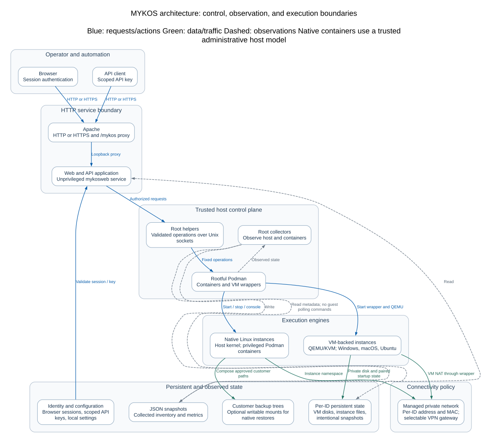
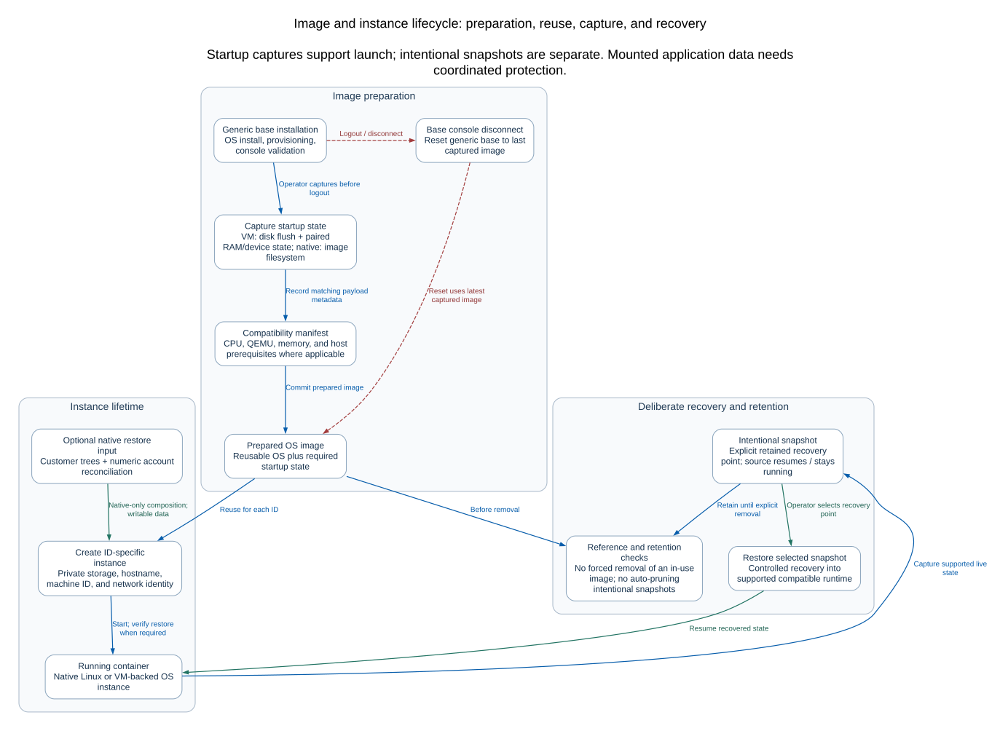

# MYKOS developer’s guide

[Documentation index](README.md) · [Architecture](ARCHITECTURE.md) · [API](API.md)

**A handoff for the person who has to understand, change, and support this code.**
The baseline is **1.5.20261024-147**, Git commit
`64f1c0ef725961f8be8d40e71c681a678713811d`, published 29 October 2026.
The architectural walkthrough retains that baseline. Host-platform notes below
reflect current RHEL 9/RHEL 10 support; RHEL 8 host support has been dropped.
Local changes are not proof that a feature shipped. The separate PXE work is unpublished.

**Find your way:** [Code map](#repository-map) · [Installed state](#source-code-versus-installed-state) · [Request walkthrough](#one-request-from-click-to-completion) · [Local setup](#get-a-safe-local-development-environment) · [Making changes](#how-to-make-a-change) · [Tests](#tests-and-what-they-establish) · [Troubleshooting](#debug-by-locating-the-boundary-that-failed) · [Release workflow](#from-a-change-to-an-installed-release)

## Start here

MYKOS makes a complete customer environment available from a prepared operating
system and, where selected, an existing customer backup. It adds a browser and
API control plane to an operator toolkit built around rootful Podman, Linux
systemd, native Linux containers, QEMU virtual machines, and customer backup and
repository workflows. It is a host management application with substantial root
privileges behind it. It is not just a dashboard over disposable containers.

The central design is **prepare once, reuse captured state, keep each customer’s
identity and writable state separate**. Native Linux shares the host kernel.
Windows, macOS and Ubuntu run inside QEMU, inside a Podman wrapper. Their installed
disks and paired RAM/device state are prepared for reuse. A running wrapper is
not proof that its internal OS has finished restoring or is ready to use.

If you have an hour, read this page through the request walkthrough, then inspect
`services/web/app.py`, `services/web/container_admin.py`,
`services/helpers/mykos-container-helper`, and `bin/mykos-install` in that order.
Read the tests for the feature before changing its implementation. For an
inherited incident, start with the troubleshooting table rather than restarting
things to see whether the symptom disappears.

## What was built and why it is shaped this way

The older shell menus and customer-data conventions remain part of the product.
The maintained Python web/API, socket helpers, workers, state handling, image
pipelines and packaging wrap and extend those workflows. Some old names and
hard-coded paths survive. This is a description of the resulting system and its
constraints, not a claim that every file was created in the same development pass.

| Design choice | What it accomplishes | Consequence for the next developer |
| --- | --- | --- |
| Prepared OS plus captured startup state | Reuses installation and startup work | Disk, RAM, devices and image metadata must agree; a disk-only substitute is not equivalent |
| Customer backup composition | Makes an existing customer environment usable without a full data copy | Selected backup paths are mounted read/write; application writes can change the source backup |
| Unprivileged web service plus root helpers | Keeps HTTP processing separate from host mutation | Every action needs HTTP authorization and narrow helper validation |
| Queued workers for long operations | Lets browser requests finish without owning the operation’s lifetime | “Queued” is not “done”; clients must observe job state |
| Host-side cached observation | Avoids running repeated guest diagnostics for every browser | Freshness, identity and unknown values are part of correctness |
| Explicit state ownership and locks | Avoids two requests manipulating the same guest or capture | A second lock with a different name is not a substitute for the existing lifecycle lock |
| Generated installation copies | Adapts kickstarts to the builder without destroying operator recipes | Change `pos/prepare_ks.py`, and preserve the source kickstarts |
| Separate authentication systems | Separates humans, API consumers, guest accounts and backup transport | A browser session, API key, guest password and VPN PSK are not interchangeable |

The owner has observed fast startup with compatible prepared state and available
customer backups. There is no controlled benchmark in this guide. Measure on the
target hardware before promising a startup time or concurrency level.

## Repository map

Paths below are relative to the source root. File names are useful search targets;
they are not all standalone commands.

| Area | Begin with | What belongs here |
| --- | --- | --- |
| Browser UI | `services/web/index.html`, `terminal-window.html` | Dashboard markup, styles, JavaScript, polling, terminal popup |
| HTTP application | `services/web/app.py` | Browser login/session routes, browser operations, route assembly |
| API v2 | `services/web/api_v2.py`, `image_build_api.py` | Key-authenticated integrations and read models |
| Web-to-root bridge | `services/web/container_admin.py`, `mykos_admin_api.py` | Structured requests to fixed privileged operations |
| Root dispatch and workers | `services/helpers/mykos-container-helper` | Action allowlist, validation, job queue and lifecycle dispatch |
| Shared host primitives | `services/helpers/mykos_runtime.py` | Trusted config, command execution, identity selection, socket peer checks |
| Native Linux instances | `mykos_linux.py`, `mykos-stage-pos` | Native lifecycle, guest selection, mounts and limits |
| VM instances and storage | `mykos_vm.py`, `mykos-desktop` | OS definitions, private disks, checkpoints and restore |
| OS image preparation | `mykos_image_build.py`, `mykos_image_admin.py` | Unattended builds, capture, image catalog, reset and removal |
| Base console ownership | `mykos_base_session.py`, `mykos-terminal-helper` | One editor, terminal transport, reset on disconnect |
| Live snapshots | `mykos_snapshots.py`, `mykos_criu.py` | Native CRIU and VM state capture/restore |
| Backup composition | `mykos_backup_restore.py`, `mykos_backup_identity.py`, `mykos_profiles.py` | Direct mounts and instance-only account reconciliation |
| Networking | `mykos_network.py`, `mykos_vpn_gateway.py`, `mykos_vpn_host.py` | Bridge allocation, shared routing and IPsec policy ownership |
| VPN connection generation | `pos/pos`, `pos/host-vpn`, `pos/vpn-updown`, `pos/vpn-restore` | Interactive workflow, selectors, secret files and hooks |
| Observation | `services/web/collect-*.py`, `host_monitoring.py`, `host_history.py` | Inventory, bounded host observations and retained history |
| Service definitions | `services/systemd/` | Socket activation, workers, collector timers and boot order |
| Installation and packages | `bin/mykos-install`, `bin/mykos-bootstrap`, `bin/mykos-package`, `packaging/rpm/` | File plan, setup, backups, source archives and RPMs |
| Existing operator toolkit | `MENU`, `pos/`, `back/`, `repo/`, `data/` | Text administration and customer-specific legacy workflows |
| Regression evidence | `tests/` in Git | Python tests, Node `.cjs` checks and separately run Linux probes |
| Documentation sources | `docs/`, `tools/docs/` | Maintained guides, graph models, rendering, link checks |

The UI is largely one large HTML file with inline code. Search for the route,
button class or function involved before editing it. Treating it as an assumed
React/Vite project will lead you to the wrong build and test workflow.

## Source code versus installed state

There are several copies of the code on an installed host. Editing the wrong one
is a common reason a change appears to have no effect, or disappears on update.

| Path | Purpose and owner |
| --- | --- |
| `/usr/share/mykos` | RPM-owned source/toolkit payload |
| `/usr/local/share/mykos` | Installer-managed toolkit/runtime source copy |
| `/opt/mykos-web` | Deployed web app and collectors; service runs as `mykosweb` |
| `/usr/local/sbin/mykos-*` | Installed privileged entry points and Python helper modules |
| `/etc/systemd/system/mykos-*` | Installed units; `@PYTHON@` is substituted at install time |
| `/etc/mykos` | Host configuration and environment; keep secrets private |
| `/var/lib/mykos-installer` | Installer manifest and ownership/recovery bookkeeping |
| `/var/backups/mykos-installer` | Deployment rollback archives and release evidence |
| `/home/mgreen/mykos` | This deployment’s operator source copy; not a portable requirement |

Make the change in maintained source, verify it, then use the installer/package
workflow. A hot edit to `/opt/mykos-web` is not a complete source change. The
installer manifest and RPM ownership are separate records; updating a live file
by hand can make verification fail even if the app still runs.

Runtime customer state lives outside normal source payloads:

| State | Principal location | Preserve when changing code |
| --- | --- | --- |
| Browser accounts/sessions and notes | `/opt/mykos-web/data/auth.db` | Password hashes, accounts, shared and personal notes |
| API key digests/revocations | `/opt/mykos-web/data/api_keys.db` | Existing integrations and revocations |
| Collected read models | `inventory.json`, `data/status.json`, `data/details.json`, `data/extended.json` under web root | Saved metadata and observation timestamps |
| Host history | Web `data/host-history.sqlite3` | Real retained samples, not invented history |
| Per-ID jobs | `/var/lib/mykos/jobs` | Queued/running/final operation state |
| VM registry | `/usr/local/share/mykos/pos/.vm` | Original identity, OS, image and storage mapping |
| VM disks and startup state | `/home/mykos-vms` | Customer private disks and matching startup captures |
| Customer backup | `/backups/tfrsync-ID`, or configured `backup_root` | Live mounted data; not disposable test fixtures |
| Native IPsec/private restore files | `pos/.ID` in the installed toolkit | PSKs, reconnect ownership and instance-private `/etc` exceptions |
| Shared VPN profiles | `/var/lib/mykos/vpn-gateways` | Gateway identity, route ownership and recovery state |
| Intentional snapshots | Configured snapshot storage | User-selected recovery points, separate from automatic startup state |

Do not copy production databases or guest disks into a development checkout.
Application updates preserve pane notes, personal notes, and shared customer-ID
notes. Notes remain private under their existing access controls. An automated
maintenance workflow may use private notes only with the owner's explicit authorization.

## One request from click to completion



[Open full-size architecture diagram](diagrams/architecture.svg) ·
[Editable Mermaid](diagrams/architecture.mmd)

Take **Start an existing container** as the example:

1. JavaScript in `index.html` sends a same-origin browser request to the public
   `/mykos/api/web/containers/ID/start` route. The public `/mykos` proxy prefix is
   different from the internal FastAPI route `/api/web/containers/{shop}/start`.
2. `app.py:mykos_start_container` checks the browser user’s operational permission,
   requires the configured Origin and validates the eight-digit ID. Hiding a
   button in JavaScript does not authorize the operation.
3. `container_admin.invoke('start-pos', shop)` sends one newline-terminated JSON
   object, `{"args":["start-pos","12345678"]}`, over the Unix socket
   `/run/mykos-container-admin.sock`. It waits for a bounded response, not a shell.
4. systemd accepts the connection and starts `mykos-container-admin@.service` as
   root. `mykos_runtime.connection()` checks Unix peer credentials: only root or
   the `mykosweb` service UID may call it. This identifies the web service, not the
   human user; the HTTP layer must already have checked the user.
5. `mykos-container-helper` validates the action and arguments, resolves the
   existing managed instance, acquires its job lock, checks for an active worker,
   saves a `queued` job, and starts `mykos-stage@ID.service` without blocking.
6. That unit invokes the same helper with `--stage-worker ID`. The worker records
   `running`, dispatches to native Linux or VM lifecycle code, then records `done`
   or `failed`. It uses the existing instance, not a fresh image clone.
7. A completed action attempts an ID-scoped collector refresh through
   `mykos_refresh.refresh`. If that refresh fails, the action can still be `done`
   with a refresh warning. Failure to refresh the UI is not proof that Start failed.
8. The browser polls job status and collected inventory. Only after observing
   the appropriate completed/readiness state should it present the action as
   finished. For VMs, Podman running and installed-OS readiness are distinct.

The API v2 route follows its own API-key authorization and then converges on the
helper. It does not reuse a browser cookie as an API key. Terminal traffic uses a
separate socket and readiness/error handshake because an interactive PTY is not
a JSON action result.

Not every operation uses the per-ID queue. Image builds have their own unit and
state directory; scheduled commands have another queue; some bounded diagnostics
return synchronously. Follow the actual action’s dispatch path before adding a
new worker or assuming an existing response means the job finished.

## Authentication and privilege boundaries

Browser roles in this release are `user` and `admin`; API scopes are `read` and
`admin`. The proposed application-specific role matrix is not implemented. Saved
RTI/Dove labels and preview visibility do not establish backend access control.

Browser login stores scrypt password hashes and hashed session tokens. Sessions
use HttpOnly, SameSite=Strict cookies; the Secure flag is enabled for HTTPS and
disabled by default IP-only HTTP setup. Browser modifications require Origin.
API keys arrive in `X-MYKOS-API-Key`; the stored values are digests, and revocation
is checked on subsequent requests. Private pane/personal notes are a deliberate
exception to the general v2 key pattern: they require the named `mgreen` session.

Root helper authorization is a second layer, not a replacement for HTTP roles.
Use fixed operations, strict argument counts, identity checks, bounded output,
subprocess argument arrays and timeouts. Never add a general HTTP-to-root shell
string. The separate scheduled-command feature is intentionally administrative;
its existence does not authorize arbitrary execution through a new read endpoint.

The host and guest terminal actions are already highly privileged. Session power
command guards protect against accidental shutdown; an administrator with root
is not confined by those shell wrappers. For Windows use the QEMU guest agent,
for Ubuntu the private serial console, and for macOS its SSH workflow. Do not
replace those with a public unauthenticated shell because it is easier to debug.

## Get a safe local development environment

Use a normal user account on a workstation for web/model tests. Host lifecycle
integration belongs on a disposable compatible Linux server. Running the web app
on macOS does not validate Podman, CRIU, KVM, systemd, bridge NAT or IPsec.

For a reproducible starting point, use the Git release commit in a new checkout.
Keep an existing checkout’s local changes rather than resetting it:

```bash
git clone https://github.com/Mykol71/mykos.git mykos-dev
cd mykos-dev
git switch -c developer-handoff 64f1c0ef725961f8be8d40e71c681a678713811d
python3.12 -m venv .venv
. .venv/bin/activate
python -m pip install -r services/requirements.txt pytest httpx
python -c 'import hashlib; assert hasattr(hashlib, "scrypt")'
```

Use Python 3.12 as a workstation test interpreter. Supported hosts are RHEL 9
with packaged Python 3.11 and RHEL 10 with distribution `python3`. RHEL 8 is no
longer a supported host; its guest images are a separate compatibility target. Runtime direct dependencies are pinned in `services/requirements.txt`;
test dependencies in the command above are not a complete locked environment.
Record resolved versions when reproducing a failure. Node is used for the plain
`.cjs` UI checks and documentation tooling; it is not the deployed web server.

The full Git checkout contains the broader regression suite. The packaged source
archive contains only selected tests because `bin/mykos-package` derives most of
its file list from installed payloads. Do not confuse a six-file packaged tests
directory with the complete project test suite.

### Work with isolated data

`MYKOS_BASE` changes the web application’s data root. It does not relocate every
privileged helper’s hard-coded system paths. Use explicit temporary state and
nonexistent socket paths; never point a local browser at a production root socket.

```bash
export MYKOS_BASE="$(mktemp -d /tmp/mykos-dev.XXXXXX)"
export MYKOS_PUBLIC_ORIGIN=http://127.0.0.1:8001
export MYKOS_SECURE_COOKIE=0
export MYKOS_CONTAINER_SOCKET="$MYKOS_BASE/no-container-service.sock"
export MYKOS_TERMINAL_SOCKET="$MYKOS_BASE/no-terminal-service.sock"
mkdir -p "$MYKOS_BASE/data"
cp services/web/index.html "$MYKOS_BASE/index.html"
printf '%s\n' '{"nodes":[]}' > "$MYKOS_BASE/inventory.json"
python services/web/manage.py users create developer --role admin
```

The last command prompts for a development-only password and writes only to the
isolated database. Start this limited web preview from the repository root:

```bash
python -m uvicorn app:app --app-dir services/web --host 127.0.0.1 --port 8001
```

Open `http://127.0.0.1:8001/`. FastAPI’s `root_path` describes the deployed proxy
prefix; it is not automatically a local `/mykos` route mount. Dashboard JavaScript
uses public `/mykos/...` URLs, so a full interactive dashboard needs a local proxy
that strips that prefix or an isolated mounted-app harness. Direct local routes
and `TestClient` use paths such as `/api/login` and `/api/v2/overview`.

This minimal preview has no root helper, live inventory or guest operations.
Some panes will report unavailable services. Use test fixtures that mock the
bridge for UI/API development. Setting `MYKOS_BASE` alone does not make it safe
to run installed collectors or host helpers on a workstation.

### A first request without a running server

The following example proves the read-model/API-key path using a temporary
fixture. Run it in a fresh interpreter from the source root after activating the
venv. It imports the app only after setting the temporary data root:

```python
from pathlib import Path
import json
import os
import sys
import tempfile
import time
from fastapi.testclient import TestClient

with tempfile.TemporaryDirectory(prefix="mykos-dev-") as temporary:
    base = Path(temporary)
    (base / "data").mkdir()
    os.environ["MYKOS_BASE"] = str(base)
    os.environ["MYKOS_CONTAINER_SOCKET"] = str(base / "no-host-service.sock")
    sys.path.insert(0, str(Path("services/web").resolve()))
    import app
    import mykos_api_keys

    (base / "inventory.json").write_text(json.dumps({
        "nodes": [{"id": "12345678", "name": "Development fixture"}]
    }))
    (base / "data/status.json").write_text(json.dumps({
        "collected_at": int(time.time()),
        "observations": {"12345678": {"status": "online"}}
    }))
    key = mykos_api_keys.create("development", "read")
    with TestClient(app.app) as client:
        response = client.get("/api/v2/nodes", headers={
            "X-MYKOS-API-Key": key
        })
        assert response.status_code == 200, response.text
        assert response.json()["nodes"][0]["id"] == "12345678"
        assert client.get("/api/v2/nodes").status_code == 401
        print("Authenticated fixture request passed; no host helper invoked.")
```

The fixture’s details/extended observations are intentionally missing. Their
freshness remains false; an online basic observation is not permission to invent
other metrics. Do not print the generated key or reuse it outside the fixture.

## State, concurrency and failure rules

An image is a reusable installed OS plus required startup state. A container is
an ID-specific instance with its own identity and writable state. A snapshot is
an intentional capture of a live instance and leaves that instance running.
These names describe different ownership and deletion rules.



[Full-size lifecycle diagram](diagrams/image-lifecycle.svg) ·
[Editable Mermaid](diagrams/image-lifecycle.mmd)

Preserve these constraints when changing lifecycle code:

- Resolve an ID to exactly one managed container. Reject duplicate or ambiguous
  identities; never take the first Podman result. Validate original labels, full
  container IDs, storage paths and namespace identity before destructive work.
- Per-ID jobs serialize operations for that instance. `mykos_vm.locked()` protects
  the shared registry/lifecycle. Base consoles also have session ownership and
  capture/reset coordination. Trace lock acquisition order before nesting them.
- Publish state atomically. Existing writers use a temporary file, flush/fsync as
  appropriate, then replace the destination. A partially written JSON file must
  not become the next reader’s authoritative state.
- Queue the work, persist transitions, and record failure. Do not return `done`
  before image commit, memory restore or the operation’s readiness checks finish.
- Preserve a previously valid image/capture until replacement succeeds. A failed
  commit can be retried from retained prepared state instead of reinstalling.
- Capture base edits before logout. Disconnect queues reset from the latest
  captured image; uncaptured edits are intentionally discarded. Existing customer
  instances are not refreshed by capturing a new generic base.
- Keep intentional snapshots separate from automatic startup captures. Deletion
  and purge need dependency/ownership checks, not an image-name wildcard.

Several Podman launch operations are placed in delegated systemd scopes by
`mykos_runtime.podman_scope`. A short-lived worker’s control group must not take a
persistent container monitor down when the worker exits. Preserve this when
refactoring process launching.

## Areas where a plausible change can break customers

### Backup data and accounts

Native restore can mount `/usr2`, `/d`, complete `/etc`, `/home` and `/usr/java`
directly read/write from a customer backup. It prepares only the new stopped
guest’s image root and overlays private files for passwd/group/shadow/gshadow,
host identity, mount tables, network ownership and PAM limits. UID/GID conflicts
must be resolved deliberately. Do not “fix” ownership with a host-wide `chown` or
rewrite the backup’s account databases. Password hashes are sensitive even when
no plaintext password is present. See [backup mount details](INSTALL_SERVICES.md#complete-customer-backup-mounts).

### Networking and VPNs

The usual private bridge is `mykos-lan`, `192.168.22.0/24`; the physical LAN is a
separate network. Native direct tunnels terminate in the guest namespace. Shared
mode can terminate in a selected native guest or the host; the host controller
owns scoped routes, firewall rules and host-output diversion. Host-only VPN is a
legacy site-selector mode, not shared full tunnel. A reported local SA is not
proof of remote DNS or internet forwarding.

The reconnect/guard files, numeric peer endpoints, full-tunnel owner and
boot-order guards are functional state. Do not clear them to make a UI indicator
green. Read the [VPN architecture and recovery procedure](NETWORKING.md#vpn-architecture-and-operations)
and its diagrams before changing this area. The existing Add Gateway issue was
deferred; this guide does not claim it was fixed. MYKOS-to-MYKOS peers are future work.

### Memory and consoles

New native ID-specific containers use a 2 GiB Podman limit and a read-only cgroup
mount; this is different from allocating RAM inside a QEMU VM. Native consoles
use `su - root`; complete backup `/etc` mounts need their private PAM limits file.
VM runtime policy is 2048 MiB and captures must match the allocation. macOS
installation temporarily uses more memory before runtime capture. Preserve the
separate Windows guest-agent, Ubuntu serial and macOS SSH console paths.

## Observation is not the operation itself

Collectors build snapshots read by browsers and APIs. The basic collector normally
runs 15 seconds after the previous run finishes; details and extended collectors
normally use 30-second intervals. This is not one synchronous query per browser.
API v2 considers these snapshots fresh for 120 seconds. Host history independently
retains 30 minutes of real samples at a three-second target interval.

Keep `collected_at`, identity and unknown values together. A previous observation
of a reused ID must not be silently assigned to a different container. Do not
convert null/stale data into a healthy-looking zero. Preserve saved inventory
metadata such as shop name, POS label and coordinates during refresh. A browser
that opens after an action should converge on the same shared state as one that
was already open.

Add a metric at the observation layer, publish it with freshness, expose it through
the appropriate read model, then render it. Do not add periodic `podman exec` in
JavaScript or a GET handler just to populate a cell. Use existing host-side batched
observation/cache patterns. Application alert fields and automated compliance
scans discussed elsewhere are plans, not released monitoring guarantees.

## How to make a change

### A new read-only field

First decide which layer owns the truth. For an inventory/host metric, find its
collector and the API v2 join in `snapshot()`. Add the field without discarding
other IDs’ rows or saved metadata. Define missing and stale behavior, then update
the browser renderer and API schema/documentation where appropriate.

Test at least a fresh value, missing observation, stale observation and changed
container identity. Count host/guest calls to ensure a new UI poll did not create
new per-guest work. Do not run a real customer diagnostic to prove formatting.

### A new operation

Choose browser permissions and API scope first. Validate the HTTP body, Origin
for browser writes, and the same arguments again in the helper. Use a fixed
allowlisted action and existing identity/lock helpers. If the operation can take
longer than a bounded request, use the appropriate queue and publish final state.

An effective operation test checks denial before side effects, the exact selected
identity, handling of duplicate/concurrent requests, failure after partial work,
and preservation of unrelated data. Mock system calls at the boundary. A test
that merely repeats the same `if` statement as the implementation gives little
confidence about those properties.

### An OS or image-building change

Review all participating registries rather than adding a dropdown alone:
`mykos_runtime.NATIVE_OS_NAMES` / `STAGE_OS_NAMES`, `mykos_vm.VERSIONS`, the image
build request validator, native kickstart mapping, image catalog, UI family
mapping, and snapshot identity. Unsupported legacy installation paths are not
automatically compatible with modern unattended answer files.

Keep operator kickstarts intact. Generated build copies handle parser differences,
firmware/microcode exclusions and boot tmpfiles nologin prevention. Builder
credentials, callback tokens and per-build private packages are not source assets.
Use the existing cleanup and scoped completion mechanisms; never put passwords in
process arguments or broad callback URLs. See [unattended builds](IMAGE_BUILDS.md).

### A UI change

Find the existing event handler and render function. Check popup/focus/disconnect
behavior as well as appearance. Capture-phase row handlers can intercept nested
action buttons; a click that looks correct can still open the wrong action.
Keep escaping/accessibility names and read-only permissions intact. Use existing
`tests/*.cjs` checks and a browser preview with fixture data, then inspect the
actual result rather than relying on a DOM string match alone.

### A documentation change

Edit maintained Markdown, `tools/docs/diagrams.json`, or the shared stylesheet.
The flower in the header comes from the existing
`services/apache-index/mykos-flower.svg`; keep one source for that logo. Add new
guides to `tools/docs/guides.json` and `services/web/supporting_docs.py`. The viewer
uses an explicit public allowlist and a fixed light theme; do not expose arbitrary
source paths or runtime files to make repository links work.

```bash
npm --prefix tools/docs ci --ignore-scripts
node tools/docs/build.mjs
python tools/docs/check.py
node tools/docs/build.mjs --check
python -m pytest -q tests/test_supporting_docs.py
```

The `.mmd` and `.svg` diagrams are generated from the same graph model; SVG layout
uses Graphviz. Generated HTML and diagrams are bundled for servers without Node.
Do not edit `docs/rendered` as the primary source or rerun the old one-time
formatting migration. Preserve `KEY_ISSUES.md` and the historical Word guide.
[Full documentation workflow](DOCUMENTATION_BUILD.md).

## Tests and what they establish

From a full Git checkout, start with relevant tests:

```bash
python -m pytest -q tests/test_api_identity.py
python -m pytest -q tests/test_helpers.py tests/test_image_admin.py
python -m pytest -q tests/test_backup_identity.py tests/test_backup_restore.py
node tests/test_container_actions.cjs
```

For a planned release, use the broader regression suite on a compatible test host:

```bash
PYTHONDONTWRITEBYTECODE=1 python -m pytest -q -p no:cacheprovider tests
for test in tests/*.cjs; do node "$test" || exit 1; done
```

Python tests use temporary filesystems/databases and mocked Podman/systemd/socket
boundaries. Some Linux-specific behavior needs its own environment; inspect each
probe before running it. Scripts named `*_probe.py` are not interchangeable with
mocked unit tests and may launch real isolated resources. Use an explicitly
allocated test host/storage, never live customer IDs or a shared Podman store by
accident. Staging with `bin/mykos-install --root` exercises file plans without
activating services; it does not prove Linux guest behavior.

Known historical kickstart-parity failures have appeared in earlier test records.
Record exact failures against the chosen baseline; do not silently delete tests
or report an old pass count as a result for the current tree. During this handoff,
two OpenAPI path assertions also failed on the unchanged release147 source under
the bundled workstation FastAPI 0.162.0/Pydantic 2.14.1, newer than the pinned
0.128.8/2.13.5 runtime. These are recorded baseline/environment failures, not a
passing release qualification; reproduce with the pinned runtime before changing
API behavior to satisfy a different dependency version. A passing mocked
suite proves decisions/protocol handling, not functioning KVM, CRIU restore,
remote Meraki routing, real OS provisioning or secure multi-tenant isolation.
Fresh RH9/RH10 package/app/login evidence used isolated RHEL UBI init systems;
full bare-metal virtualization validation is a separate task.

## Debug by locating the boundary that failed

| Symptom | First place to inspect | Common misunderstanding |
| --- | --- | --- |
| 401 after login | Cookie scheme/host, session and expiry | A Secure cookie is not sent over HTTP |
| 403 on a browser write | Role and exact configured Origin | A visible button or API key does not establish a browser session |
| 503 container service unavailable | Socket path, socket unit and helper journal | Restarting the web app cannot create a missing privileged socket |
| Job remains queued/running | `mykos-stage@ID.service`, saved job, selected identity | Accepted request is not completed work |
| Action finished but row is old | Scoped refresh warning, collector timestamps | Retrying an already completed mutation can create a second problem |
| Podman running but VM unavailable | VM readiness, guest-agent/serial/SSH path and RAM restore | Wrapper state is not guest readiness |
| Base edits disappeared | Capture completion versus console disconnect | Logout deliberately resets uncaptured changes |
| New code has no effect | Which source/runtime copy and process are active | Editing RPM source does not automatically change deployed web files |
| Install verify reports changes | Installer manifest versus operator edits | A failed checksum is not permission to overwrite the file |
| Site VPN up, DNS/internet down | Default CHILD_SA, XFRM selectors, remote forwarding/NAT | Site SA alone does not prove full tunnel |
| Console fails with backup restore | Instance-private `/etc` mounts and PAM limits | Fixing the shared backup in place can damage the customer data source |

For approved host inspection, use bounded logs and status queries:

```bash
sudo systemctl status mykos-web.service mykos-container-admin.socket --no-pager
sudo journalctl -u mykos-web.service -n 100 --no-pager
sudo journalctl -u mykos-stage@12345678.service -n 100 --no-pager
sudo /usr/local/sbin/mykos-vpn-gateway list
```

Substitute the intended ID; a status command is not authorization to restart,
remove or reconfigure it. Do not post secrets, database copies, private keys or
raw key-bearing IPsec state in an issue. Use `ip xfrm state list nokeys` when
kernel IPsec state is necessary. Reproduce the failure in a fixture or allocated
test environment before changing production.

## From a change to an installed release

The source file plan in `bin/mykos-install` drives most packaging. A new file can
be in Git yet absent from the package if it is outside the included directories.
`bin/mykos-package` adds selected source/build files and writes a per-file
`SHA256SUMS` plus an archive checksum. Inspect the produced archive, not just the
working directory. Never package a mixed checkout containing unpublished work.

The RPM spec selects EL9/EL10 host requirements and Python paths and rejects
EL8 host builds. RHEL 8 guest images remain supported. `noarch`
means the payload is not CPU-specific; it does not make a package interchangeable
between host majors. Build and sign with the existing protected signing workflow;
private signing keys stay outside source and packages. Verify the signed bytes
before repository publication and refresh only the intended MYKOS repository.
Do not invent an Azure remote: GitHub is configured; Azure needs a specific target.

Before a change batch and again immediately before promotion, compare and preserve
both production documentation folders. Reconcile operator edits, preserve POS and
kickstart fixes, rebuild the documents, and recheck. Protect current guest IDs,
start times, disks, snapshots, users, key digests and existing Apache settings.
Keep a rollback archive and the exact source digest, release number, dependency
record and verification results. A successful app restart is not enough evidence.

Use [signed installation/update procedures](RPM.md) for deployment and
[installer recovery](INSTALL_SERVICES.md) for rollback. An installer source/code
backup is not a complete customer-disk backup. Restoring identity data can also
restore old session/revocation state, so data rollback is an explicit decision.

## What the next maintainer should know is unfinished

The API and source still mix historical names (`shop`, `shopcode`, internal
`template` role values) with current user-facing ID/image terminology. Preserve
stored/API compatibility while improving prose. Authentication checks and OS
registries span several modules, and `index.html` is large; refactoring should
first add boundary coverage, then consolidate behavior in small reviewable steps.

The released README can lag the maintained task guides. In this baseline it still
mentions automatic domain HTTPS, whereas actual setup defaults to IP HTTP and
requires `--configure-https` for domain/Certbot setup. Verify against released
installer code and [bootstrap instructions](BOOTSTRAP.md). Do not repeat obsolete
README assumptions in a new implementation.

Unpublished PXE changes, application-specific multi-role authorization,
MYKOS-to-MYKOS VPN peers, configurable application alert fields and automated
compliance scanning are not established released capabilities. Some private
build/sign/promotion scripts are deployment-specific automation, not a complete
portable CI service. Existing test evidence has practical host/OS limits. Preserve
these distinctions instead of claiming that passing tests settles them.

## A useful handoff for your own next change

Leave the next human the problem and trigger, the files/entry points changed, why
the chosen layer owns the behavior, state that must survive, and the failure and
rollback behavior. Include exact test commands and current results, a source
commit/digest and any environment limitation. For UI work include an actual
screenshot; for a traffic change include the namespace and return path. This is
more useful than a list of edited filenames or a transcript of implementation.
