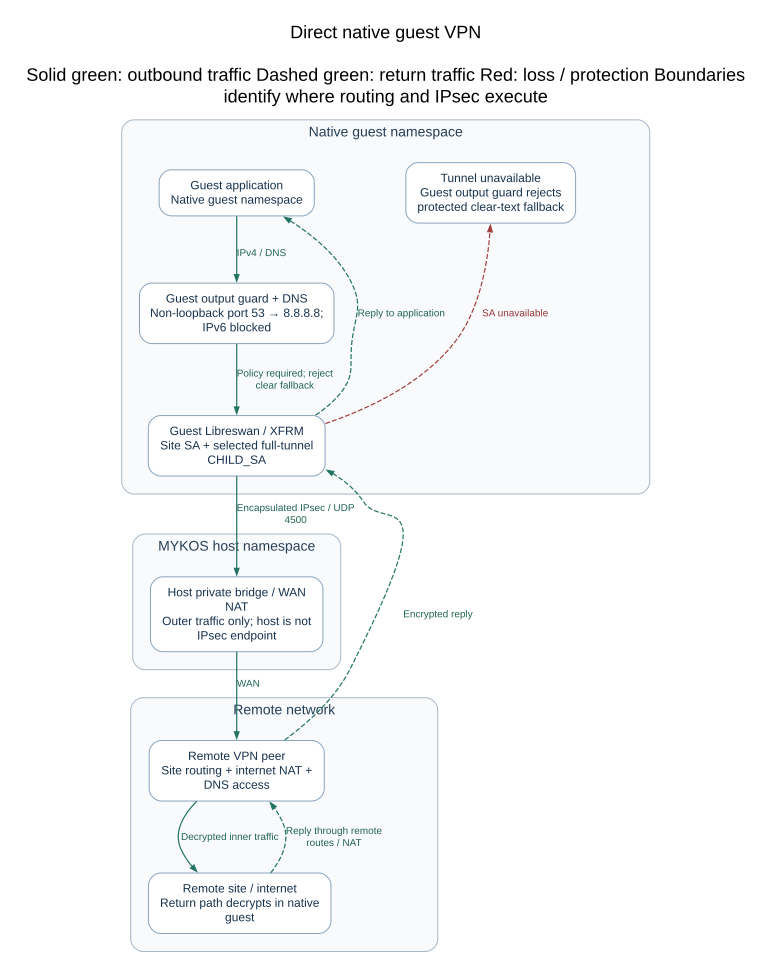
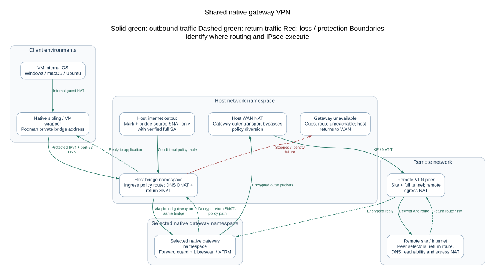
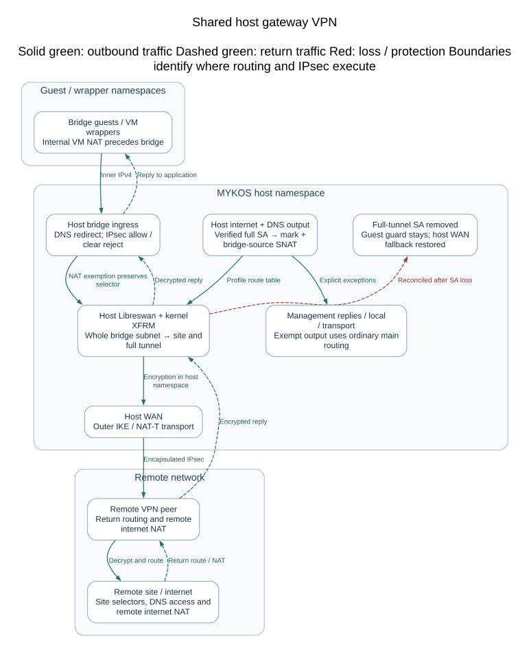
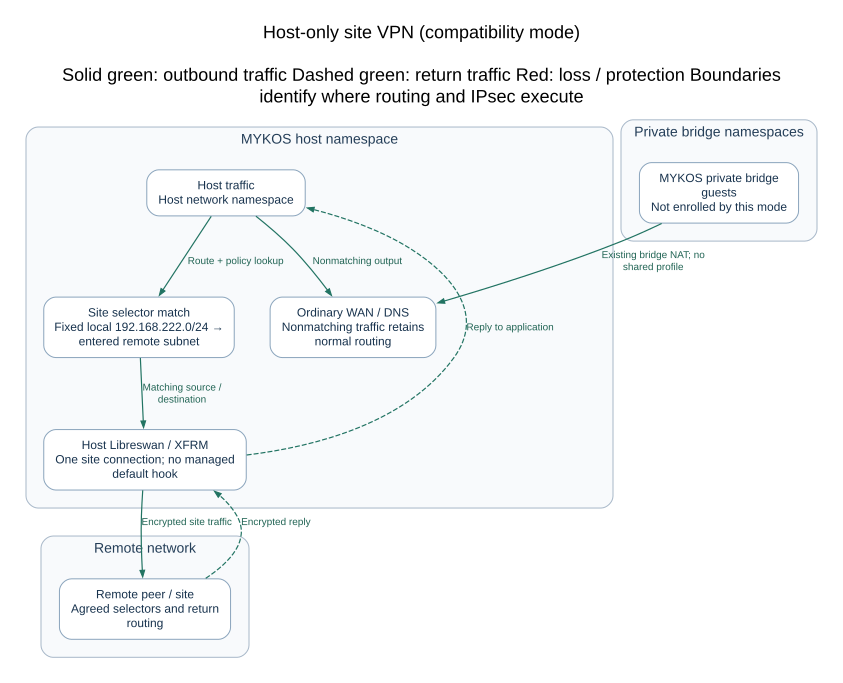

# Managed container networking

[Documentation index](README.md)

Both dev and production use the rootful Podman bridge `mykos-lan` with private NAT, subnet `192.168.22.0/24`, gateway `192.168.22.1`, and container addresses `.2` through `.254`. The same subnet on two separate hosts does not connect those networks together. The host LAN addresses remain unchanged. This works through Ethernet or Wi-Fi.

Set `native_network_driver` to `bridge`, `native_network` to `mykos-lan`, and `native_network_subnet` to `192.168.22.0/24` in `/etc/mykos/config.json`. Initialize with `sudo /usr/local/sbin/mykos-network-setup` or `mykos-setup --native-network`. A new network is refused if the subnet overlaps an existing host route. Existing mismatched networks are left unchanged and must be replaced explicitly while unused.

New native Linux instances, native image build containers, and Windows/macOS/Ubuntu VM wrappers use this network. Each gets a fixed `--ip` address and deterministic MAC, recorded in its Podman configuration and MYKOS labels. A shared lifecycle lock serializes assignment; stopped containers retain their address claims. Addresses exclude the gateway/network/broadcast, and a full pool fails before creation. Stop/start preserves the assigned address. Deleting the container releases its claim. VM-internal guest NICs retain their QEMU-managed networking; the displayed Podman NIC belongs to the VM wrapper.

There is no pipework or guest dhclient dependency. NAT guests do not have individual `192.168.222.x` LAN addresses. Direct inbound LAN services need explicit publishing or routing; MYKOS terminals, guest-agent commands and HTTP desktops remain server-proxied. IPsec tunnel configuration and NAT-T need validation for the chosen peer/subnets; existing LAN-specific VPN selectors are not automatically rewritten.

Optional `native_network_driver: macvlan` retains LAN DHCP mode on a wired parent selected with `network_device`. CNI uses `cni-dhcp.socket`; Netavark uses `netavark-dhcp-proxy.socket` for that optional mode. Private bridge mode uses neither. The primary interface is eth0, selected by labels; legacy eth1 monitoring and `eth1_ipv4` API aliases remain for compatibility with old instances. API clients should use `network.ipv4` and `network.interface`.

Existing running containers are not silently rewired. Recreate legacy pipework or older-network containers after preserving any needed data. New instances use the configured bridge.

<!-- contents:start -->
**Contents**

- [Linux root terminals](#linux-root-terminals)
- [Windows PowerShell action](#windows-powershell-action)
- [macOS shell action](#macos-shell-action)
- [Native OS minor versions](#native-os-minor-versions)
  - [Meraki peer updates](#meraki-peer-updates)
- [VPN modes and persistence](#vpn-modes-and-persistence)
  - [Meraki update checks](#meraki-update-checks)
- [Geographic map](#geographic-map)
- [VPN architecture and operations](#vpn-architecture-and-operations)
  - [Choose the tunnel owner and traffic scope](#choose-the-tunnel-owner-and-traffic-scope)
  - [Direct native guest traffic](#direct-native-guest-traffic)
  - [Shared native gateway traffic](#shared-native-gateway-traffic)
  - [Host shared gateway traffic](#host-shared-gateway-traffic)
  - [Host-only traffic](#host-only-traffic)
  - [Prerequisites and peer agreement](#prerequisites-and-peer-agreement)
  - [Persistence and reconnect boundaries](#persistence-and-reconnect-boundaries)
  - [Safe operational checks](#safe-operational-checks)
  - [Failure and recovery procedure](#failure-and-recovery-procedure)
  - [Deliberate removal](#deliberate-removal)
  - [Implementation evidence and validation limits](#implementation-evidence-and-validation-limits)

<!-- contents:end -->

## Linux root terminals

Native RedHat terminal actions execute `/bin/su - root` through Podman. Ubuntu VM terminal actions connect directly to a private QEMU serial Unix socket and its guest ttyS0 service running `/bin/su - root`. They use no SSH, LAN IP, wrapper shell, or public console port. Only one direct console may be open per Ubuntu instance. Browser graphical console remains available through the separate console-log icon.

Run the Ubuntu image setup script inside the installed guest before capture; it configures both swap and the direct serial root-console service. Use `sudo python3 /tmp/mykos-ubuntu-setup.py --console-only` to configure only the terminal. The service grants root to holders of the VM serial console, matching the admin-only native root terminal. Existing images need this setup and the updated QEMU serial configuration before the new terminal works.

## Windows PowerShell action

The Windows/Windows Server login icon opens an admin PowerShell command console through QEMU Guest Agent, without RDP or a guest network connection. Install and start the Windows QEMU Guest Agent before capture. Each entered line runs separately under that service account, with a 120-second timeout and bounded output; interactive applications and persistent PowerShell session variables are not supported. The console-log icon remains the graphical browser desktop; existing RDP API links remain available for clients that still need them.

## macOS shell action

The macOS login icon opens SSH through the VM's private Podman bridge address, prompts for the macOS username/password, and confirms the guest host key. Enable Remote Login for the intended user in System Settings > General > Sharing before capture. The account's normal shell is opened; no SSH key or password is stored by MYKOS. No additional host-public SSH ports are opened. The console-log icon opens the HTTP graphical desktop through the existing Apache-authenticated browser-console proxy, as it does for Windows and Ubuntu.


## Native OS minor versions

Native image builds store full VERSION_ID (for example 8.10 or 9.8) in the `io.mykos.os.version` image label. For older images without that label, the collector reads os-release from a host-mounted immutable image once and stores a root-owned cache keyed by its image digest under `/var/cache/mykos/image-os`. Future polls use the cache, never guest execution. New image content gets a new cache key; an unavailable version is retried after one hour. Purge removes this cache. The API and container Version column use the same full image version.


### Meraki peer updates

The optional Meraki upload first downloads the organization's complete third-party
VPN peer list, then appends the new peer and sends the combined list. Existing
peer objects and their settings are preserved. Failed downloads or invalid JSON
stop the update. An identical named peer is a no-op; a same-name peer with different
settings is rejected rather than overwritten. New peers do not reuse a fixed peer
ID. API headers and downloaded configuration use private temporary files which
are removed when the operation ends. Avoid simultaneous changes in Dashboard or
other API clients during an update: this endpoint replaces the complete peer list.

## VPN modes and persistence

The detailed architecture, mode comparison, traffic paths, prerequisites and
recovery procedure are in [VPN architecture and operations](#vpn-architecture-and-operations).

New native Linux VPN setup offers independent guest tunnels or one shared default
gateway. Independent mode supports multiple distinct remote site subnets, multiple
guests to one site, and one remote site per guest. The first successfully connected
tunnel owns that guest's default traffic. IKEv2 liveness checks run every 30 seconds with a 45-second retransmit timeout;
host fallback waits until the local full-tunnel SA is actually removed, rather
than assuming a peer is down from one lost packet. Rekeying does not change ownership; when
the primary connection is removed, the earliest remaining established connection
is promoted. Internet traffic and non-loopback DNS use that selected full tunnel.
The DNS resolver is `8.8.8.8`. Generated configurations explicitly use `pfs=no` to match the existing Meraki
child-SA policy. Default stanzas are rendered independently because overriding
`also=` values is rejected by the tested Libreswan 4.x parser. See the
[Libreswan configuration reference](https://libreswan.org/man/ipsec.conf.5.html).
A separate default CHILD_SA uses `0.0.0.0/0`; a site
SA alone is not evidence of working full-tunnel internet access.

Shared mode supports either the MYKOS host or one native Linux guest as gateway.
It routes all MYKOS guest types through that gateway and routes host internet
traffic through it only after a matching full-tunnel SA is confirmed. Local host
management replies and outer IKE/NAT-T/ESP transport are exempt. During an outage,
protected guest traffic remains blocked; ordinary host WAN internet is restored.
Only one shared default gateway may be selected. Combining this mode with other
independent VPN configurations is currently rejected before local setup or a
Meraki upload; existing tunnels are left unchanged.

The existing customer `pos/.ID` folder remains mounted read/write at guest
`/etc/ipsec.d`. Connection, secret, numeric endpoint, reconnect hook and default
ownership/order files live there. Native setup checks the running guest's mount
identity and required executables from a fixed host Python process, without
executing guest code. The actual systemd reload/enable still runs inside the guest.
Missing dependencies fail before the optional Meraki upload. Existing global
IPsec configuration is preserved, with narrow include globs appended and a private
backup before the first change. Secrets remain in mode-0600 per-connection files.

The shared controller stores root-only profiles under
`/var/lib/mykos/vpn-gateways`. Its boot guard protects configured guest routes
before Podman automatic restart; its timer reconciles only explicitly configured
profiles. Installing/updating MYKOS does not select a gateway, rewrite existing
VPNs or enable these optional units. Removing the last profile disables the timer
and guard. Uninstall deactivates owned routing/firewall changes while retaining
operator profiles; explicit container-state purge removes profiles too.

The IP address expansion shows network metadata, VPN connections and an icon
map. **Show connected guests** adds shared-network members and gateway dependents.
Green links require reported SA state; grey/dashed links are unconfirmed. A network
membership edge does not prove connectivity. Read models use saved host metadata
and cached kernel observations, never PSKs or extra guest polling.

Ubuntu-specific new VPN/shared-folder work is deferred. Its released VM creation,
RAM capture and existing individual VPN paths are unchanged. Shared host/native
routing can still carry traffic from its wrapper, as for Windows and macOS.

### Meraki update checks

The chosen remote public endpoint must uniquely identify one network in the
configured Meraki organization. New peers are restricted to that network; MYKOS
does not fall back to all networks. Network-ID binding and route-based peer settings
require MX 19.1 or newer. MYKOS checks the actual MX device firmware, since a
network's displayed upgrade target can exceed the hardware's supported release.
For older MX devices, direct mode offers an explicit site-only policy VPN. It
adds a dedicated, organization-unique network tag while preserving existing tags,
and assigns the new peer only to that tag. It omits unsupported network-ID and
route-based fields. Existing peers remain intact. The local connection has only
the requested site subnet, with no default CHILD_SA, internet/DNS guard, or default
gateway election; ordinary internet routing is unchanged. Legacy shared gateway
modes are rejected before any upload. See Cisco's
[third-party VPN peer API](https://developer.cisco.com/meraki/api-v1/update-organization-appliance-vpn-third-party-vpn-peers/).

MYKOS downloads and preserves the complete peer list, rechecks for concurrent
changes immediately before PUT, and verifies the returned public peer settings.
An invalid/unverifiable response aborts local configuration and activation; an
ambiguous remote result must be checked in Dashboard before retrying. There is
no atomic compare-and-swap provided by this workflow, so avoid simultaneous
Dashboard/API edits even with that recheck. No whole-organization rollback or blind
retry is attempted. Router-side internet forwarding/NAT and actual MX negotiation
still need validation for the selected site; local SA state alone does not prove
remote internet egress.


## Geographic map

Click the host IP address to expand the existing geographic map beneath the host
row. It uses saved inventory latitude/longitude values and marks current node
status. Nodes without valid saved coordinates are omitted rather than placed at
an invented location. Closing the pane retains the map for reopening; no extra
guest collection or IP geolocation lookup is performed.


Map points are IDs and saved host locations. Hovering a point shows the available
shop name, hostname, configured POS type, OS/IP/status, and saved application
information. Green means up, red means down, and yellow means unknown. Optional
`shop_name`, `pos_type`, and `app_info` node metadata survives collection. Host
locations can be saved in the inventory `hosts` list with `hostname`, `lat`, and
`lon`; the current host's cached status is joined by hostname. No saved location
means no map pin. POS permission enforcement is separate from these display fields.

## VPN architecture and operations

This describes the released **1.5.20261024-146** implementation. Examples use the
usual `192.168.22.0/24` private bridge; inspect the site's configuration before
using any address. This review did not add, remove or reconnect a live VPN.

### Choose the tunnel owner and traffic scope

| Selection in Add VPN | IPsec process and kernel policies | Local site selector | Traffic included | Host participation |
| --- | --- | --- | --- | --- |
| Native guest: direct guest tunnel (1) | Guest network namespace | That guest's bridge IPv4 `/32` | Guest's site traffic; first connected site also owns a separate full tunnel | Host retains ordinary WAN routing |
| Native guest: gateway for all MYKOS guests (2) | Selected native Linux guest namespace | Entire MYKOS bridge subnet | Bridge guests, including VM wrappers, use one full-tunnel gateway | Host internet joins only after full-tunnel verification |
| Host: host only (1) | Host network namespace | Legacy fixed `192.168.222.0/24` | Matching site-selector traffic; no managed full-tunnel default | Does not enroll the MYKOS private bridge |
| Host: shared gateway for all guests and host (2) | Host network namespace | Entire MYKOS bridge subnet | Guest forwarding through host IPsec and selected host output | Conditional host full-tunnel diversion |

Host-only's fixed selector and IKE IDs (`192.168.222.0`) are compatibility
behavior, not automatic LAN discovery. It must match the site's actual routing
and peer configuration. Do not assume it protects bridge guests or offers the
shared modes' DNS redirection and fail-closed guards. The shared selection permits
one gateway profile and rejects mixing with other saved independent connections.
Direct mode permits multiple remote sites and multiple guests per site, but saved
selectors must be distinct and accepted by the remote peer.

### Direct native guest traffic



[Editable Mermaid source](diagrams/vpn-direct.mmd)

An application packet enters the guest's IPsec policy, is encrypted there, and
crosses the Podman veth/private bridge as outer traffic. Normal bridge NAT carries
that outer IKE/NAT-T transport to the WAN. The host does not become the guest's
IPsec endpoint. UDP 500/4500 to saved numeric peers is exempt from the guest guard;
the generated connection forces encapsulation. Return traffic traverses host NAT
and is decrypted inside the same guest namespace.

Every managed native connection has a site CHILD_SA and a separate
`CONNECTION-mykos-default` CHILD_SA with remote selector `0.0.0.0/0`. The first
successful site connection atomically claims `.mykos-first-tunnel`; its hook
asynchronously starts that default CHILD_SA after returning to Libreswan. A site
SA alone therefore does not prove internet access. The hook records establishment
order in `.mykos-connected-order`. Rekeying retains ownership. Explicitly removing
the owner promotes the earliest remaining established site. A temporary outage is
not documented as automatic failover to another site: the owner marker remains
and the guard stays installed for reconnect.

Non-loopback UDP/TCP port 53 output is DNATed to `8.8.8.8` and follows the full
tunnel. A local loopback DNS stub remains local; its upstream request is subject
to the same rule. IPv6 output is rejected except loopback, since no IPv6 tunnel
is configured. This is port-53 handling, not a claim that arbitrary encrypted
DNS protocols are rewritten. Other outbound packets need IPsec policy or are
rejected once the full-tunnel guard has been installed. Do not treat Add VPN's
success message as proof that the first SA and guard are already established.

### Shared native gateway traffic



[Editable Mermaid source](diagrams/vpn-native-gateway.mmd)

A sibling's IPv4 packet reaches the host bridge gateway. A source-, destination-
and ingress-scoped policy rule selects a private routing table whose default is
via the selected native gateway address on that bridge. A higher-priority rule
keeps the gateway's own outer transport on the main routing table. Host forwarding
and NAT exemptions preserve the protected bridge subnet instead of masquerading
it before encryption. Inside the gateway namespace MYKOS enables IPv4 forwarding
and installs policy-allow then reject rules. The gateway encrypts the packet;
outer traffic returns through the bridge and normal WAN NAT. Decrypted replies
return to the bridge guest.

The gateway profile pins the original full container ID, bridge and IPv4 address.
A replacement guest with a reused eight-digit ID is not silently trusted. If the
container is missing/stopped, MYKOS keeps an unreachable default in its owned
route table; an SA outage in a running gateway is blocked by its forwarding
IPsec-policy guard. VM traffic includes the wrapper boundary: Windows/macOS/
Ubuntu internal guest NAT reaches the wrapper, then the common Podman bridge.
This does not turn the VM's internal NIC into a directly routed site address.

Host bridge-ingress UDP/TCP port 53 is redirected to `8.8.8.8`. Redirected DNS is
source-translated to the host bridge address so replies return through host
conntrack and reverse DNAT, even when the native gateway and client are siblings.
These DNS rules remain during outages, preventing bridge DNS from escaping through
host WAN fallback. IPv6 bridge forwarding and bridge-local port-53 input are blocked.

### Host shared gateway traffic



[Editable Mermaid source](diagrams/vpn-host-shared.mmd)

There is no gateway container in this mode. The host Libreswan process and host
kernel XFRM policies encrypt bridge traffic using the whole bridge subnet as local
selector. Owned forwarding rules allow protected IPsec traffic and reject clear
fallback. NAT exemptions preserve the inner source subnet. Marked bridge-local
XFRM exceptions permit local requests and decrypted replies without treating
clear WAN packets as authenticated tunnel traffic. Guest DNS uses the bridge
redirection/return-NAT path described above.

In **both shared modes**, host internet diversion requires an outbound full-tunnel
policy whose selector matches the bridge subnet, whose ESP template targets the
saved numeric peer, and whose request ID matches an actual ESP tunnel state.
A UI green site link or an IKE SA alone is insufficient. The controller marks
selected host output (`0x4d590000/0xffff0000`), uses the profile's route table, and
SNATs sources outside the bridge subnet to its bridge address to match the VPN
selector. Incoming management replies, outer UDP 500/4500 and ESP, loopback,
link-local, multicast and connected networks have bypasses. Non-loopback port-53
DNS is marked before connected-network exemptions and redirected to `8.8.8.8`.
The host IPv6 guard blocks internet/DNS escape while diversion is active, retaining
local and management-reply exceptions. The bridge reverse-path filter temporarily
uses loose mode and its saved setting is restored on deactivation.

When the full-tunnel policy/state disappears, reconciliation removes host output
diversion so ordinary host internet uses WAN again. **Guest protection remains.**
Detection follows Libreswan SA lifetime and a periodic controller; it is not an
instant end-to-end health check. A stale local SA can still blackhole traffic.

### Host-only traffic



[Editable Mermaid source](diagrams/vpn-host-only.mmd)

This compatibility path writes a host site connection without the full-tunnel
hook or shared-gateway profile. The generated connection uses `left=%defaultroute`
and the fixed local subnet above. Normal host DNS and nonmatching traffic keep
ordinary routing. Ensure host IPsec is available/running and selector-compatible;
this mode does not provide the shared controller's managed all-guest behavior.

### Prerequisites and peer agreement

Before an authorized setup, establish all of the following:

1. A reachable IPv4 peer endpoint, nonoverlapping remote IPv4 site subnet, agreed
   PSK and IKE identities, and WAN permission for IKE/NAT-T. Shared mode requires
   the MYKOS private NAT bridge and a started native Linux gateway when guest-owned.
2. Native guest VPN dependencies and the correct customer folder bind-mounted at
   `/etc/ipsec.d`. `vpn-preflight` checks exact mount identity and fixed required
   executables through the host, without running arbitrary guest code. Actual
   service preparation and Libreswan commands subsequently run inside the guest.
3. Agreement on IKEv2, the generated proposals (`aes128-sha1-dh21`, ESP
   `aes128-sha1`, `pfs=no`), selectors and IKE IDs. Native direct local IDs derive
   from `ID.hostname`; shared-host IDs derive from hostname; remote IDs derive
   from the entered endpoint. Non-IP IDs are rendered with `@`. These are the
   released interoperability settings, not an assertion that every peer accepts them.
4. Remote support for both the site and full-tunnel CHILD_SAs where applicable,
   return routing for the local `/32` or bridge subnet, and remote internet
   forwarding/NAT for `0.0.0.0/0`, including the selected DNS resolver.
5. If using optional Meraki upload: organization permissions, a unique network
   match for the entered public endpoint, and peer settings compatible with MX
   19.1+ network binding/route-based fields. Enter the remote network as a canonical
   CIDR; a bare address receives `/24`. MYKOS is policy/XFRM based locally even
   though its Meraki request uses `isRouteBased` for native/shared-host peers.

The interactive Add VPN path performs public-IP discovery using `ifconfig.me`.
That is part of setup, not a required read-only diagnostic. Do not run Add VPN
merely to inspect architecture. Local preflight precedes optional Meraki writes;
a successful remote upload can still be followed by a later local setup failure.
There is no distributed rollback transaction. Reconcile actual Dashboard peer
state before any retry after an ambiguous response or partial setup.

### Persistence and reconnect boundaries

| State | Location and meaning |
| --- | --- |
| Native connection/PSK/hook/peer | Host `pos/.ID`, mounted at guest `/etc/ipsec.d`; per-connection files, secrets mode 0600 |
| Host connection/PSK/hook/peer | `/etc/ipsec.d/mykos-*`; existing global includes preserved with private backups |
| Default owner/order | `.mykos-first-tunnel`, `.mykos-connected-order` and locks in the owner's IPsec directory |
| Shared profile | Root-only `/var/lib/mykos/vpn-gateways/*.json`; owner, selectors, bridge, table, address, pinned identity |
| Shared observations | `vpn-gateways/status`; cached result expires after 65 seconds |
| Host-output recovery state | `vpn-gateways/host-output`; previous reverse-path setting and exact owned rules |

Connections use `auto=start`, 30-second liveness checks and a 45-second retransmit
timeout. Hooks keep numeric peer endpoints so reconnect does not need DNS outside
the tunnel. DNS address changes are not automatically re-resolved: review/recreate
an affected connection deliberately. Native prepare installs an `ExecStartPre` restore helper
in the IPsec service drop-in to reapply an existing selected-owner guard. Do not delete
owner files or disable guards as an outage workaround.

Selecting a shared profile enables `mykos-vpn-gateway-guard.service` before
`podman-restart.service` and `mykos-vpn-gateway.timer` (20 seconds after boot,
then 30 seconds after each reconciliation finishes). The guard blocks configured
guest forwarding before automatic restart. Installation alone does not select a
gateway or enable these optional units. Profiles do not establish that remote
egress works; always assess freshness and the full data path.

### Safe operational checks

The following host commands inspect state. Substitute the intended **native**
guest ID for `12345678`; do not use a VM wrapper as a native IPsec namespace.
Do not copy PSKs or raw configuration files into tickets.

```bash
sudo rpm -q mykos
sudo /usr/local/sbin/mykos-vpn-gateway --help
sudo /usr/local/sbin/mykos-vpn-gateway list
sudo systemctl status mykos-vpn-gateway.timer mykos-vpn-gateway-guard.service --no-pager
sudo journalctl -u mykos-vpn-gateway.service --since '-15 minutes' --no-pager
sudo podman network inspect mykos-lan
sudo ip -4 rule show
sudo ip -4 route show table all
# Host-owned IPsec; nokeys is essential for kernel state inspection:
sudo ipsec status
sudo ip xfrm policy list
sudo ip xfrm state list nokeys
# Native guest dependency/mount preflight and collected VPN summary:
sudo /usr/local/sbin/mykos-linux vpn-preflight 12345678
sudo /usr/local/sbin/mykos-linux vpn 12345678
```

`list` returns shared profiles and cached observations, not independent connections.
An empty list with disabled optional units is normal when no shared gateway is
selected. Use host IPsec status or the intended guest's VPN summary for other modes.
For a native namespace's kernel state, an administrator can resolve its exact
running container PID via `podman inspect` and use `nsenter --target PID --net --`
with `ip xfrm policy list` and `ip xfrm state list nokeys`. Reconfirm identity/PID
immediately; the controller itself pins namespace handles to avoid PID reuse.
Do not use `ip xfrm state list` without `nokeys`.

After setup or recovery, compare site and default CHILD_SAs, policy selectors,
profile identity, rule/table ownership and status timestamps. Proving remote DNS,
site reachability and internet egress requires separately authorized traffic from
the intended guest; a host probe cannot prove a guest's path. A reported SA is
not evidence of remote forwarding, DNS success or application availability.

### Failure and recovery procedure

| Symptom | Read-only evidence | Recovery decision |
| --- | --- | --- |
| Preflight rejected | Exact terminal error, mount/label/dependency checks, mode conflict | Correct the prerequisite in a planned change; preserve saved tunnels and remote peers |
| Site SA up, internet/DNS down | Default CHILD_SA, XFRM selector and ESP state; remote full-tunnel/NAT agreement | Repair the agreed full-tunnel path; retain guards |
| Gateway stopped or identity changed | Podman state, profile's full container ID/IP, unreachable owned route | Recover the original gateway; deliberately remove/reconfigure the profile before replacing it |
| Host WAN returns but guests blocked | Full-tunnel state absent, controller status and logs | Expected outage split; recover tunnel and check remote forwarding |
| Ownership conflict | Exact controller error plus route table/rule/firewall observations | Reconcile competing ownership before retry; helper refuses to overwrite foreign rules |
| Remote upload uncertain | Dashboard's current peer list and exact API error | Resolve remote outcome first; never retry a whole-organization replacement blindly |
| Failure after local files were saved | Per-owner connection names, loaded SAs, shared profile and terminal error | Treat as partial configuration; review all layers before approved removal/retry |

Capture the exact error and intended owner/connection first. Recheck local state
before any recovery command. `sync`, `guard`, `configure`, `configure-host`,
`remove` and `deactivate` are **mutating**, even though some print JSON; they are
not inspection commands. The existing Add Gateway failure remains deferred and
was not investigated by this documentation review.

After the diagnosed prerequisite/peer problem is resolved, an authorized operator
can retry negotiation for the **existing saved connection**, avoiding a service-wide
restart that could interrupt unrelated tunnels. For example:

```bash
# MUTATING recovery examples — choose one owner and its exact saved connection.
# Host owner (saved host names have the mykos- prefix):
sudo ipsec auto --up mykos-CONNECTION
# Native owner: use the actual existing ID.hostname and connection name:
sudo podman exec ID.hostname ipsec auto --asynchronous --up CONNECTION
# Reconcile explicitly configured shared profiles after recovery:
sudo /usr/local/sbin/mykos-vpn-gateway sync
```

These commands were not run for this review. Do not use placeholder names or
blindly retry after uncertain Meraki updates. Confirm the site and selected
default CHILD_SAs, controller freshness and expected rules afterward. If identity
or table ownership is disputed, stop and reconcile it before changing routes.

### Deliberate removal

Remove through the matching authenticated host or guest **Remove VPN** action,
select the saved connection and confirm its exact name. The workflow releases its
shared profile/owned host routing if present, removes the loaded connection and
hook/default ownership, then deletes that connection's saved files. Removing the
first direct connection can promote another established site; removing the last
managed native connection releases its output/DNS hooks. A stopped native guest
must be recovered before its interactive remove workflow can run. Do not force
remove/recreate a shared gateway guest: the delete guard requires removing its
profile first.

Profile removal releases guest protection for that profile and returns host
output to ordinary routing; plan this loss of VPN protection before confirming.
Removing only a shared profile is not equivalent to removing the saved IPsec
connection. Local removal does **not** delete the Meraki peer: coordinate remote
cleanup separately and preserve unrelated organization peers. The last profile
removal disables the optional timer/boot guard. Uninstall deactivates owned
network changes while retaining profiles; explicit container-state purge removes
them. Neither uninstall nor a documentation update is a VPN recovery procedure.

### Implementation evidence and validation limits

The mode prompts and activation/removal order are in `pos/pos`; connection rendering
and host-only behavior in `pos/host-vpn`; ownership/DNS/reconnect guards in
`pos/vpn-updown`; mount checks in `services/helpers/mykos_linux.py`; shared
routing and lifecycle in `mykos_vpn_gateway.py`; host marking/SA checks in
`mykos_vpn_host.py`; startup protection in `services/systemd/mykos-vpn-gateway*`.
These paths are relative to the released source tree, not the development PXE work.

This review checked implementation and safe installed CLI/state only. Real Meraki
negotiation, remote internet egress, DNS, reconnection after peer loss, and every
site-specific host-only selector were not re-tested. The current production
shared-profile list was empty; that observation cannot validate an active gateway.
