# MYKOS screen examples

[Documentation index](README.md) · [Example use cases](USE_CASES.md) · [Snapshot Preview](DESKTOPS.md#snapshot-preview)

Dashboard and control screenshots use **example data**: hosts, IDs, addresses, locations, metrics and terminal output are illustrative. The desktop captures show actual guest desktops through the MYKOS browser console, without customer documents or credentials. The dashboard is shown in a compact browser view.

## Performance, workloads and VPN locations

System measures the host’s root volume; Data measures the home volume. The
background map shows the MYKOS host and remote locations. A dim green line joins
the host to a location with an active VPN. Workload panes group containers and
prepared images by operating system.

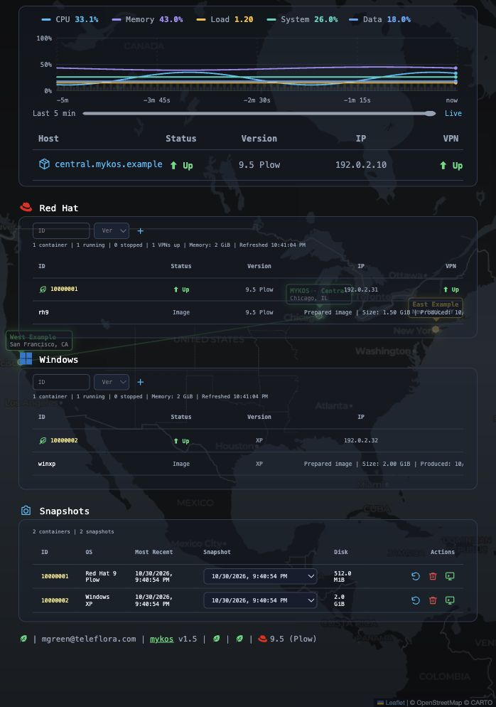

[Open the full-size dashboard image](screenshots/example-dashboard.jpg).

## Choose a snapshot and its action

Each container has its own snapshot selector. The action icons are **Restore**,
**Delete** and **Preview**, from left to right. Preview opens a separate instance;
Restore replaces the original container’s current state.

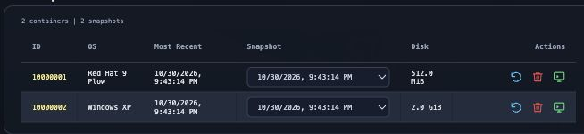

[Open the full-size snapshot actions image](screenshots/example-snapshot-actions.jpg).

## Inspect saved files in a separate console

A native Linux snapshot opens a filesystem-only shell with copied saved files and
no guest network access. Captured RAM and services are not resumed. The original
container stays unchanged, and preview changes are discarded when the temporary
session closes. Desktop VM previews can instead resume their saved RAM and disks.

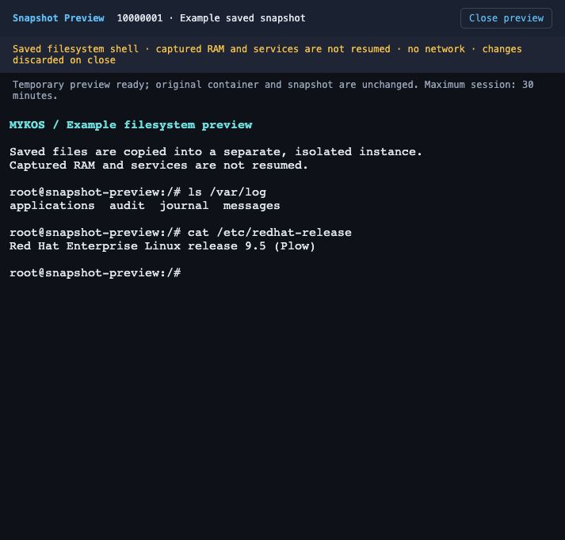

[Open the full-size preview image](screenshots/example-snapshot-preview.jpg).

See [Snapshot Preview](DESKTOPS.md#snapshot-preview) for session limits, automatic
cleanup and the difference between native and desktop previews.

## Windows XP workflow

These examples use the actual MYKOS controls with an illustrative prepared XP image and instance. They show the UI workflow, not a newly tested Windows XP installation. Bring your own properly licensed Windows installation media and application software; see [licensing](LICENSING.md).

### 1. Select the prepared XP image and an instance ID

Prepare and validate a `winxp` image using the [image-build workflow](IMAGE_BUILDS.md), then open the Windows pane. Enter an eight-digit instance ID, select **XP**, and use the blue **Start** plus. Confirm the selected ID and image when prompted.

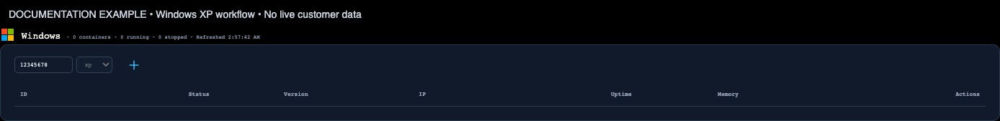

### 2. Open and manage the XP instance

Once startup completes, the row shows **Up**, its XP version, address, uptime and memory. Use **HTTP graphical desktop** to open the guest console. The row also provides Start, Stop, Snapshot and Delete controls. Stop retains the instance disks; Delete removes the instance and its saved data after confirmation.

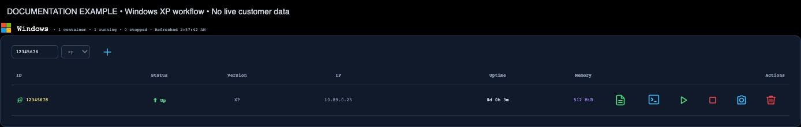

### The Windows XP desktop in the browser console

Opening **HTTP graphical desktop** brings up the guest’s actual graphical console. This capture shows the Windows XP desktop, including its Start menu button and taskbar. Guest OS activation and all vendor licensing requirements remain the operator’s responsibility.

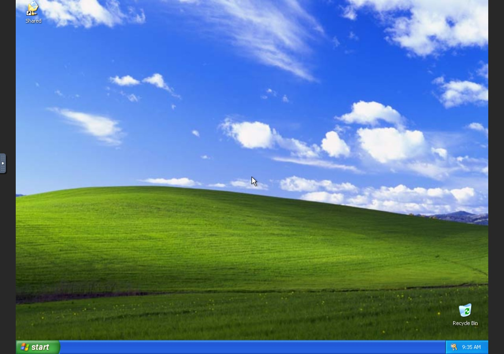

[Open the full-size Windows XP desktop](screenshots/example-winxp-desktop.jpg).

### 3. Choose a saved recovery point

Use **Snapshot container** on the running instance to save a recovery point. In the Snapshots pane, select that instance's saved timestamp. **Preview** opens a separate temporary inspection session, **Restore** replaces the original instance's current state after confirmation, and **Delete** removes the selected snapshot. See [Snapshot Preview](DESKTOPS.md#snapshot-preview) for limits and cleanup behavior.

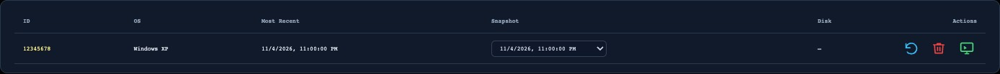

## Ubuntu desktop workflow

Prepare a compatible Ubuntu desktop image using the [image-build workflow](IMAGE_BUILDS.md). In the Ubuntu pane, choose the prepared version and enter an eight-digit instance ID, then use the blue **Start** plus and confirm the selection. When the instance reports **Up**, open **HTTP graphical desktop** and sign in with the guest account configured for that image.

The browser console opens the actual Ubuntu graphical desktop. This capture shows the desktop with its dock, Home and Trash icons. Each customer instance keeps its own accounts, configuration and data; the shared prepared image provides the starting OS environment.

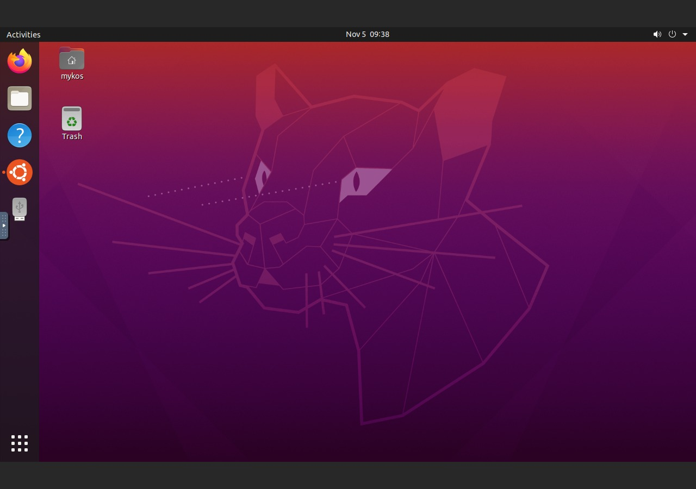

[Open the full-size Ubuntu desktop](screenshots/example-ubuntu-desktop.jpg).

Use the instance row’s Stop and Start controls to retain and resume its disks, and Snapshot to capture a supported recovery point. See [Snapshot Preview](DESKTOPS.md#snapshot-preview) before choosing Preview or Restore.

## macOS workflow

This example uses a prepared **macOS 12 Monterey** (`mac12`) image and illustrative instance data. Follow the [image-build workflow](IMAGE_BUILDS.md) to prepare and validate the image first. All applicable Apple operating-system and application licensing requirements apply; see [licensing](LICENSING.md).

### 1. Select macOS and an instance ID

Open the macOS pane, enter an eight-digit instance ID, choose the prepared Monterey image, and use the blue **Start** plus. Confirm the selected image and ID when prompted.

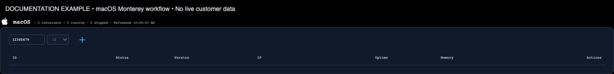

### 2. Open the instance console

When startup completes, the instance row reports **Up** with its address, uptime and memory. Use **HTTP graphical desktop** to open the guest's browser console and use its macOS desktop. The example below shows the MYKOS controls for that instance.

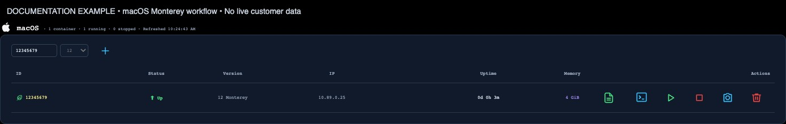

[Open the full-size macOS instance example](screenshots/example-macos-instance.jpg).

Use **Stop** and **Start** to retain and resume the instance's disks. **Delete** removes that instance and its saved data after confirmation.

### 3. Choose a snapshot recovery action

Use **Snapshot container** on a running instance to save a supported recovery point. In the Snapshots pane, choose that instance's saved timestamp. **Preview** opens a separate temporary session, **Restore** replaces the original instance's state after confirmation, and **Delete** removes the selected recovery point. Read [Snapshot Preview](DESKTOPS.md#snapshot-preview) before choosing Preview or Restore.

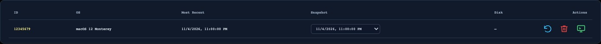

[Open the full-size macOS snapshot example](screenshots/example-macos-snapshot.jpg).
