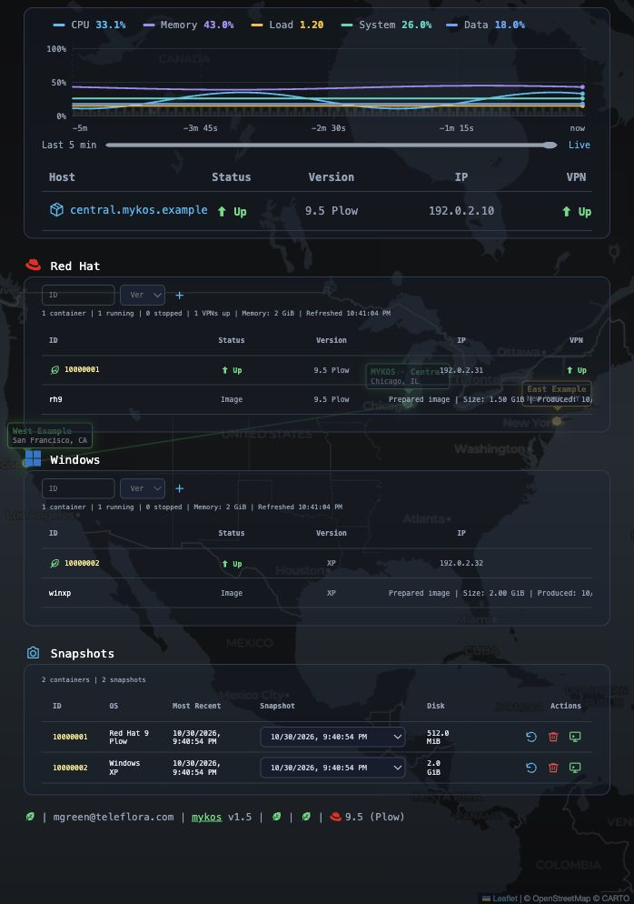
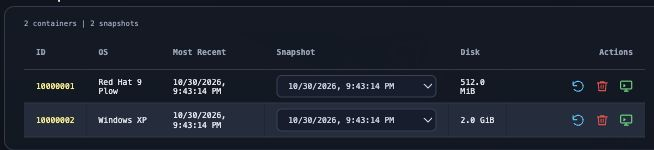
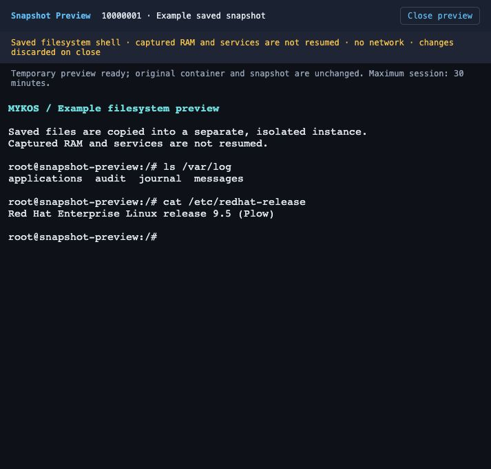

# MYKOS screen examples

[Documentation index](README.md) · [Example use cases](USE_CASES.md) · [Snapshot Preview](DESKTOPS.md#snapshot-preview)

These screenshots show the current MYKOS interface with **example data**. Hosts,
IDs, addresses, locations, metrics and terminal output are illustrative; they do
not reveal production customers or credentials. The dashboard is shown in a
compact browser view.

## Performance, workloads and VPN locations

System measures the host’s root volume; Data measures the home volume. The
background map shows the MYKOS host and remote locations. A dim green line joins
the host to a location with an active VPN. Workload panes group containers and
prepared images by operating system.

[Open the full-size dashboard image](screenshots/example-dashboard.jpg).

## Choose a snapshot and its action

Each container has its own snapshot selector. The action icons are **Restore**,
**Delete** and **Preview**, from left to right. Preview opens a separate instance;
Restore replaces the original container’s current state.

[Open the full-size snapshot actions image](screenshots/example-snapshot-actions.jpg).

## Inspect saved files in a separate console

A native Linux snapshot opens a filesystem-only shell with copied saved files and
no guest network access. Captured RAM and services are not resumed. The original
container stays unchanged, and preview changes are discarded when the temporary
session closes. Desktop VM previews can instead resume their saved RAM and disks.

[Open the full-size preview image](screenshots/example-snapshot-preview.jpg).

See [Snapshot Preview](DESKTOPS.md#snapshot-preview) for session limits, automatic
cleanup and the difference between native and desktop previews.
