# MYKOS screen examples

[Documentation index](README.md) · [Example use cases](USE_CASES.md) · [Snapshot Preview](DESKTOPS.md#snapshot-preview)

Dashboard and control screenshots use **example data**: hosts, IDs, addresses, locations, metrics and terminal output are illustrative. The desktop captures show actual guest desktops through the MYKOS browser console, without customer documents or credentials. The dashboard is shown in a compact browser view.

[Android desktop](#android-x86-desktop-workflow) · [Debian native container](#debian-native-container-workflow) · [SUSE native container](#suse-linux-enterprise-native-container-workflow)

## Performance, workloads and VPN locations

System measures the host’s root volume; Data measures the home volume. The
background map shows the MYKOS host and remote locations. A dim green line joins
the host to a location with an active VPN. Workload panes group containers and
prepared images by operating system.

[Open the full-size dashboard image](screenshots/example-dashboard.jpg).

## Choose a snapshot and its action

Each container has its own snapshot selector. The action icons are **Restore**,
**Delete** and **Preview**, from left to right. Preview opens a separate instance;
Restore replaces the original container’s current state.

[Open the full-size snapshot actions image](screenshots/example-snapshot-actions.jpg).

## Inspect saved files in a separate console

A native Linux snapshot opens a filesystem-only shell with copied saved files and
no guest network access. Captured RAM and services are not resumed. The original
container stays unchanged, and preview changes are discarded when the temporary
session closes. Desktop VM previews can instead resume their saved RAM and disks.

[Open the full-size preview image](screenshots/example-snapshot-preview.jpg).

See [Snapshot Preview](DESKTOPS.md#snapshot-preview) for session limits, automatic
cleanup and the difference between native and desktop previews.

## Windows XP workflow

These examples use the actual MYKOS controls with an illustrative prepared XP image and instance. They show the UI workflow, not a newly tested Windows XP installation. Bring your own properly licensed Windows installation media and application software; see [licensing](LICENSING.md).

### 1. Select the prepared XP image and an instance ID

Prepare and validate a `winxp` image using the [image-build workflow](IMAGE_BUILDS.md), then open the Windows pane. Enter an eight-digit instance ID, select **XP**, and use the blue **Start** plus. Confirm the selected ID and image when prompted.

### 2. Open and manage the XP instance

Once startup completes, the row shows **Up**, its XP version, address, uptime and memory. Use **HTTP graphical desktop** to open the guest console. The row also provides Start, Stop, Snapshot and Delete controls. Stop retains the instance disks; Delete removes the instance and its saved data after confirmation.

### The Windows XP desktop in the browser console

Opening **HTTP graphical desktop** brings up the guest’s actual graphical console. This capture shows the Windows XP desktop, including its Start menu button and taskbar. Guest OS activation and all vendor licensing requirements remain the operator’s responsibility.

[Open the full-size Windows XP desktop](screenshots/example-winxp-desktop.jpg).

### 3. Choose a saved recovery point

Use **Snapshot container** on the running instance to save a recovery point. In the Snapshots pane, select that instance's saved timestamp. **Preview** opens a separate temporary inspection session, **Restore** replaces the original instance's current state after confirmation, and **Delete** removes the selected snapshot. See [Snapshot Preview](DESKTOPS.md#snapshot-preview) for limits and cleanup behavior.

## Ubuntu desktop workflow

Prepare a compatible Ubuntu desktop image using the [image-build workflow](IMAGE_BUILDS.md). In the Ubuntu pane, choose the prepared version and enter an eight-digit instance ID, then use the blue **Start** plus and confirm the selection. When the instance reports **Up**, open **HTTP graphical desktop** and sign in with the guest account configured for that image.

The browser console opens the actual Ubuntu graphical desktop. This capture shows the desktop with its dock, Home and Trash icons. Each customer instance keeps its own accounts, configuration and data; the shared prepared image provides the starting OS environment.

[Open the full-size Ubuntu desktop](screenshots/example-ubuntu-desktop.jpg).

Use the instance row’s Stop and Start controls to retain and resume its disks, and Snapshot to capture a supported recovery point. See [Snapshot Preview](DESKTOPS.md#snapshot-preview) before choosing Preview or Restore.

## macOS workflow

This example uses a prepared **macOS 12 Monterey** (`mac12`) image and illustrative instance data. Follow the [image-build workflow](IMAGE_BUILDS.md) to prepare and validate the image first. All applicable Apple operating-system and application licensing requirements apply; see [licensing](LICENSING.md).

### 1. Select macOS and an instance ID

Open the macOS pane, enter an eight-digit instance ID, choose the prepared Monterey image, and use the blue **Start** plus. Confirm the selected image and ID when prompted.

### 2. Open the instance console

When startup completes, the instance row reports **Up** with its address, uptime and memory. Use **HTTP graphical desktop** to open the guest's browser console and use its macOS desktop. The example below shows the MYKOS controls for that instance.

[Open the full-size macOS instance example](screenshots/example-macos-instance.jpg).

### The macOS desktop in the browser console

After signing in to the guest, the console displays the actual macOS Monterey desktop. The desktop capture below comes from a running MYKOS-hosted macOS instance. Guest accounts and application data remain separate for each instance; Apple and third-party licensing requirements still apply.

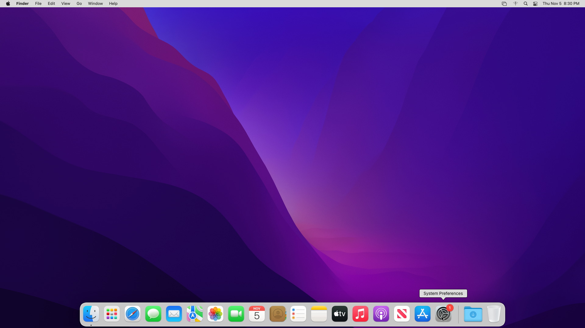

[Open the full-size macOS desktop](screenshots/example-macos-desktop.png).

Use **Stop** and **Start** to retain and resume the instance's disks. **Delete** removes that instance and its saved data after confirmation.

### 3. Choose a snapshot recovery action

Use **Snapshot container** on a running instance to save a supported recovery point. In the Snapshots pane, choose that instance's saved timestamp. **Preview** opens a separate temporary session, **Restore** replaces the original instance's state after confirmation, and **Delete** removes the selected recovery point. Read [Snapshot Preview](DESKTOPS.md#snapshot-preview) before choosing Preview or Restore.

[Open the full-size macOS snapshot example](screenshots/example-macos-snapshot.jpg).

## Fedora desktop workflow

This example uses a prepared Fedora 44 GNOME **VM** (`fedora44vm`), distinct from a native Fedora container. Example MYKOS control captures use illustrative instance data; the desktop image comes from an actual running Fedora guest.

### 1. Select the prepared Fedora desktop image

Follow the [image-build workflow](IMAGE_BUILDS.md), choose Fedora GNOME VM in the text menu and select its RAM allocation. In the Fedora pane, choose the prepared Fedora 44 desktop VM image, enter an eight-digit instance ID, and use the blue Start plus.

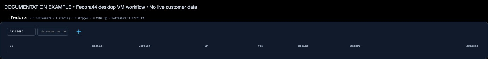

### 2. Open the running desktop

Once the instance reports Up, use **HTTP graphical desktop** and sign in to its guest account. Guest credentials are separate from the MYKOS website login.

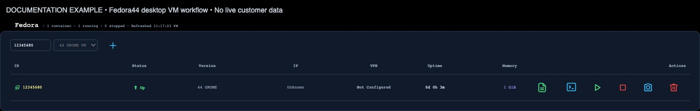

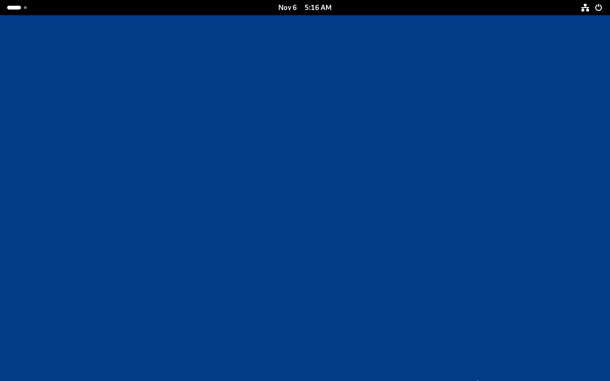

[Open the full-size Fedora desktop](screenshots/example-fedora-desktop.png).

### 3. Save and select a recovery point

Use Snapshot on the instance row. In the Snapshots pane, select the saved recovery point. Preview creates a separate temporary inspection session; Restore replaces the selected instance state after confirmation. Stop and Start retain the VM disks; Delete removes the instance and its data after confirmation. Read [snapshot guidance](DESKTOPS.md#snapshot-preview) before restoring or previewing.

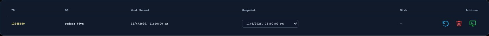

## Android-x86 desktop workflow

This example uses the legacy **Android-x86 9.0-r2 VM** (`android9`). The MYKOS
control images use illustrative prepared-image and instance data. The setup and
desktop images are actual captures from a running MYKOS-hosted Android guest.
Android-x86 9.0-r2 is an older compatibility guest; use an isolated test environment
and review the [Android image-build guidance](IMAGE_BUILDS.md#android-x86-legacy-installer).
All vendor and application licensing requirements apply.

### 1. Complete Android setup and prepare an image

Run `sudo mykos`, choose **c. Build image**, enter `android9`, and choose the
required RAM. Follow the linked manual installer instructions and open the base
image's **HTTP graphical desktop**. Complete Android's welcome wizard until the
home screen with app icons appears. Guest setup is separate from signing in to
MYKOS.

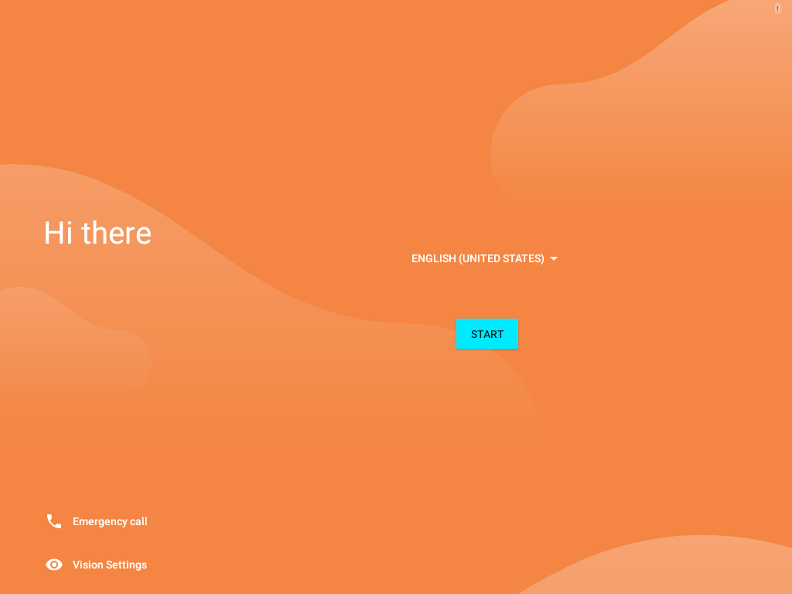

[Open the full-size Android setup screen](screenshots/example-android-setup.png).

After installation is complete, use the documented `vm prepare android9` action
to capture and validate the reusable image before creating customer instances.

### 2. Select the prepared Android image and an instance ID

Open the Android-x86 pane, enter an eight-digit instance ID, select **9.0-r2**,
and use the blue **Start** plus. Confirm the selected ID and prepared image.

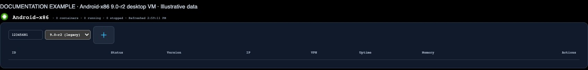

[Open the full-size Android selection example](screenshots/example-android-select.jpg).

### 3. Open the Android desktop

When the instance reports **Up**, choose **HTTP graphical desktop**. Use the
Android home screen and app launcher inside the browser console.

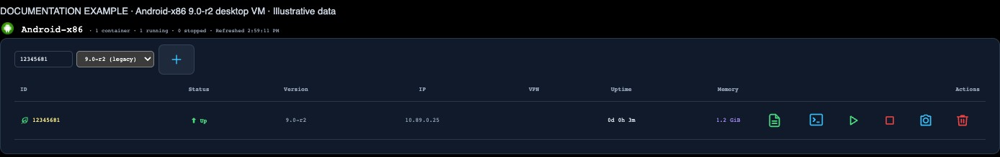

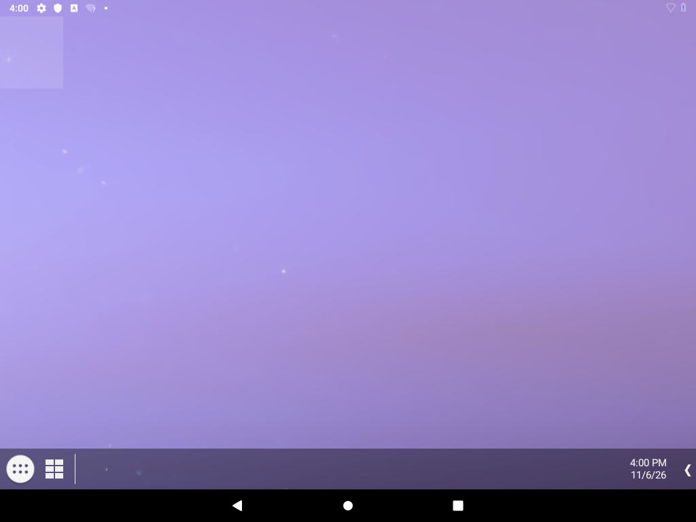

[Open the full-size Android desktop](screenshots/example-android-desktop.png).

### 4. Save and select a recovery point

Use **Snapshot container** on a supported running Android instance. In the
Snapshots pane, choose its saved timestamp. **Preview** opens a temporary VM
inspection session; **Restore** replaces that instance's saved state after
confirmation; **Delete** removes the selected recovery point. Read
[Snapshot Preview](DESKTOPS.md#snapshot-preview) for limitations and cleanup.

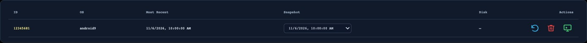

[Open the full-size Android snapshot example](screenshots/example-android-snapshot.jpg).

## Debian native container workflow

This example uses **Debian 13** (`debian13`) as a native Linux container. It
shares the MYKOS host kernel and provides a shell-based environment. The screen
examples use illustrative IDs, addresses, memory and recovery points.

### 1. Build and select Debian

Run `sudo mykos`, choose **c. Build image**, and enter `debian13`. Wait for the
individual build to complete. Open the Debian pane, enter an eight-digit instance
ID, choose **13**, and use the blue **Start** plus. Confirm the selected ID and
image. See [native image builds](IMAGE_BUILDS.md#native-el-and-other-linux-containers).

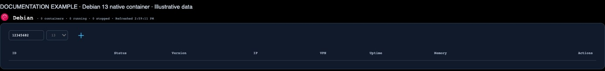

[Open the full-size Debian selection example](screenshots/example-debian-select.jpg).

### 2. Use the Debian shell and lifecycle controls

Once the instance reports **Up**, use **su - root (admin only)** to open its
terminal. Commands such as `cat /etc/os-release`, `id`, and `uname -r` identify
the guest userspace, current user and shared host kernel. Use the row's console
log to inspect startup messages. **Stop** and **Start** manage a persistent
instance; **Delete** removes its saved data after confirmation.

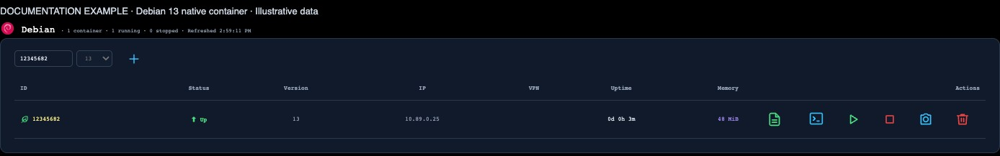

[Open the full-size Debian instance example](screenshots/example-debian-instance.jpg).

### 3. Select a Debian recovery point

Use **Snapshot container** on the supported running container. Select a saved
recovery point in the Snapshots pane. Native **Preview** opens a separate,
filesystem-only shell without guest networking; it does not resume the saved
services or RAM. **Restore** replaces the original instance's state after
confirmation. See [Snapshot Preview](DESKTOPS.md#snapshot-preview).

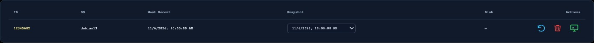

[Open the full-size Debian snapshot example](screenshots/example-debian-snapshot.jpg).

The qualified native workflow uses the default **UTC timezone and managed NAT**.
Custom-timezone snapshots and VPN creation for this family remain outside the
qualified workflow; see [image-build limitations](IMAGE_BUILDS.md).

## SUSE Linux Enterprise native container workflow

This example uses **SUSE Linux Enterprise BCI Init 15 SP7** (`sles15sp7`), the
container base supported by MYKOS. A full SLES installation, desktop environment,
subscription and paid vendor support are separate from this BCI container.
Vendor licensing and any subscription requirements for additional software apply.
The screen examples use illustrative instance data.

### 1. Build and select the SUSE BCI image

Run `sudo mykos`, choose **c. Build image**, and enter `sles15sp7`. After the
individual image is ready, open the SUSE Linux Enterprise pane, enter an
eight-digit instance ID, select **15 SP7 (BCI)**, and use the blue **Start** plus.
Confirm the selected ID and image. See [native image builds](IMAGE_BUILDS.md#native-el-and-other-linux-containers).

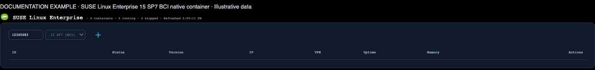

[Open the full-size SUSE selection example](screenshots/example-suse-select.jpg).

### 2. Open the SUSE container terminal

When the row reports **Up**, use **su - root (admin only)**. Inspect
`cat /etc/os-release` and `id` to confirm the SLE BCI userspace and root shell.
Native containers share the host kernel. The row also exposes console logs,
Start, Stop, Snapshot and Delete controls for the managed instance.

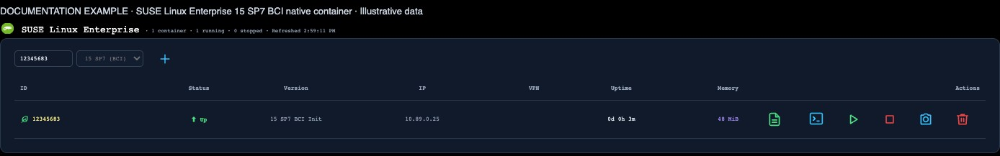

[Open the full-size SUSE instance example](screenshots/example-suse-instance.jpg).

### 3. Choose a SUSE recovery action

Use **Snapshot container**, then choose the saved timestamp in the Snapshots pane.
**Preview** provides a temporary filesystem-only shell without guest networking;
**Restore** replaces the original instance's state after confirmation. **Delete**
removes the selected recovery point. Read [Snapshot Preview](DESKTOPS.md#snapshot-preview)
before choosing an action.

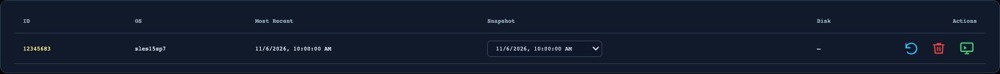

[Open the full-size SUSE snapshot example](screenshots/example-suse-snapshot.jpg).

Use the qualified **UTC / managed-NAT** native workflow. Custom-timezone snapshots
and VPN creation for this family remain unqualified; follow the current
[image-build limitations](IMAGE_BUILDS.md).
